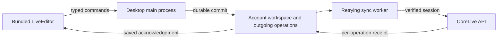

# Design: Offline LiveEditor for returning desktop users

Generated by /office-hours on 2026-10-21 (Asia/Tokyo)  
Repo: laststance/corelive · Branch: main · Inspected revision: b41775dc  
Status: IMPLEMENTATION IN PROGRESS — owner approved implementation through /ship and /electron-release with recommended decisions  
Mode: Startup, engineering continuation  
Supersedes: ryotamurakami-main-design-20260902-125500.md **only for the desktop's remote-renderer assumption**; its wider product roadmap remains in effect.

This document preserves the historical plan and implementation checkpoints. The
2026-10-22 status-visibility change supersedes its original footer/action placement;
see the [current controls and recovery guide](../offline-liveeditor.md#understand-the-status).

## Problem and agreed scope

The owner encountered a full-window category-loading error that prevented access to LiveEditor. The screenshot establishes an editing interruption; it does not establish that the connection was offline. The requested improvement is explicit: start the app without a network, write, complete a line, and synchronize after reconnection.

The owner selected returning, previously authenticated Macs and **B: always open LiveEditor from the installed app, save locally, then synchronize**. The first connected run of the upgraded app prepares the local workspace; offline readiness is acknowledged only after its account identity, category snapshot, settings, and existing notes are durably available. A still-valid existing login should bootstrap without another sign-in prompt. An old installation's past login alone cannot manufacture a missing local snapshot.

The first delivery covers writing, cached category selection, completion, existing Undo controls, restart recovery, and synchronization. Category creation/rename/deletion remains an online operation. First-ever signed-out desktop use, offline dashboards, and cross-device synchronization of draft text are outside this feature. Existing online category management remains available through its online surface.

On 2026-10-21, the owner explicitly scheduled cross-device draft synchronization for a later session in [CloudSync #206](https://github.com/laststance/corelive/issues/206). That research handoff does not defer this feature's offline completion replay after reconnection.

## Demand and current evidence

The owner requested this after a real interruption and chose the complete daily loop over editing-only recovery. There is no new evidence here about other users, willingness to pay, or market size. Current code was inspected; no offline implementation or application QA has run in this design session.

| Existing source                                                                                     | Reuse and limitation                                                                                                                                                                               |
| --------------------------------------------------------------------------------------------------- | -------------------------------------------------------------------------------------------------------------------------------------------------------------------------------------------------- |
| `apps/desktop/electron/WindowManager.ts`, `electron.vite.config.ts`                                 | LiveEditor currently loads the remote `/live-editor` page; no renderer is packaged. Cold offline startup needs a packaged screen.                                                                  |
| `apps/desktop/electron/LiveEditorNoteStore.ts`, `ConfigManager.ts`                                  | Notes already live on the device. Reuse their content and migration knowledge; separate note/config writes are not a completion transaction.                                                       |
| `apps/web/src/components/live-editor/LiveEditor.tsx`, `LiveEditorSurface.tsx`, `liveEditorUtils.ts` | Reuse editing, IME, checkbox, clear-on-complete, and presentation behavior. Extract host dependencies instead of maintaining a second editor.                                                      |
| `apps/web/src/hooks/useCompletionWriter.ts`, `useTodayKeeps.ts`                                     | Signed-in completion and counts currently depend on the server. Desktop needs local adapters.                                                                                                      |
| `apps/web/src/server/procedures/completed.ts`, `schemas/completed.ts`                               | Local imports preserve timestamps and deduplicate stable IDs, but target the default category. The existing delete endpoint has a 60-second Undo restriction. Neither API is sufficient unchanged. |
| `apps/web/src/lib/live-editor/pendingMergeStore.ts`, `localCompletionStore.ts`                      | Reuse identity/retry concepts. Browser memory fallback and sign-in-only import scheduling do not provide durable desktop recovery.                                                                 |
| `apps/web/src/app/api/orpc/[...path]/route.ts`, desktop trusted-navigation/preload helpers          | Preserve verified Clerk authentication and restricted native bridges when adding a local origin.                                                                                                   |

## Approach decision

**B, selected:** package the LiveEditor screen and make local persistence the success boundary in every network state. This is a substantial renderer, persistence, and synchronization change, with one editing path to maintain.

**A, not selected:** retain the remote screen and switch to a bundled fallback on failure. It preserves more current delivery plumbing but introduces screen-transition, draft, selection, and Undo handoff cases.

No external market research or optional outside-model opinion was requested. The design uses current repository evidence and Electron/TanStack documentation; the independent document review below is separate.

## Architecture and behavior



### Packaged screen and shared editor

Bundle the editor's scripts, styles, fonts, and required assets with Electron. Serve them from a dedicated, restricted application origin, separate from the existing `corelive://` OAuth deep-link scheme. Editing must not require Next.js, Clerk initialization, a remote font, or an API response at startup.

Extract reusable editor behavior and presentation behind host adapters into a shared package. The web adapter retains its current web/Clerk behavior; the desktop adapter receives account, category, settings, persistence, completion, and count state through the typed desktop contract. Do not import the web app into the desktop app or copy the large editor component. Validate existing native window, shortcut, sound, selection, and clear-on-complete behavior after extraction.

### Local success means a durable write

The main process is the sole writer for a versioned workspace partitioned by verified account ID. Use an atomic workspace transaction for the draft revision, local completion, outgoing operation, and Undo identity. A completion acknowledgement is sent only after that transaction is durably committed. Only then may the editor clear/mark the line, play success feedback, or increment the local count.

A completion captures the submitted document revision, stable line identity, and exact text. Serialize earlier autosaves before it and preserve later edits as subsequent revisions; reject and reconcile stale full-draft writes rather than letting them replace newer state. Typing remains available while persistence is pending. A late acknowledgement affects only its submitted line: clear or mark it only if that identity still represents the submitted content; preserve a subsequently edited line as unfinished writing. Never replace the editor with the acknowledged old snapshot. If reconciliation is ambiguous, retain the writing and expose the pending state. Engineering review chooses the operation/rebase mechanism; the invariant is that only the submitted content becomes completed and every later edit survives.

For the first implementation, use a separate per-account snapshot file with serialized writes, a unique temporary file, file flush, atomic replacement, and directory flush. Extend the existing write/rename pattern; do not put the new queue inside general settings. Keep a validated recovery copy and refuse silent reset on corruption. A failed disk write retains the editor text and reports that saving failed; memory-only storage must never be labelled saved. A storage fault blocks destructive completion feedback while copy/export remains possible.

Typing keeps the existing bounded autosave delay with an explicit saving state; hide, close, account switch, and normal quit flush pending changes before teardown. A crash can lose keystrokes that have not received a saved acknowledgement. Every acknowledged draft or completion must survive process termination and restart. Engineering review must validate snapshot cost at a stated data-volume envelope before locking the file format; a database migration is warranted if that envelope cannot meet responsiveness and durability together.

Migrate existing device notes only after matching category ownership against the authenticated account. Preserve the original files and unmapped notes; never assign orphaned notes to the current account by guess. Persist a migration receipt before marking the workspace offline-ready. Upgrade interruption must be retryable without copying a note twice or replacing newer writing.

### Category refresh and removed-category recovery

Refresh the account's category snapshot after valid-session recovery, reconnection, successful online category management, and an existing category-change notification. Refresh again when the panel becomes visible online; while it stays visible and online, use a bounded refresh interval of at most 60 seconds for changes made on other devices. A successful refresh atomically persists the new names/hierarchy plus selection and recovery metadata. Transient failures retain the last usable snapshot and never block editing. A rename preserves selection by ID; a new category appears in the picker and survives the next offline restart.

When a category disappears, retain its unfinished draft and unsynchronized operations under an accessible `Category name (removed)` recovery entry. This applies to both selected and unselected categories, including after restart. The selected draft stays open; other recovery entries remain in the picker. Writing there can continue locally, but affected records wait for a destination. Suggest a verified deletion-receipt target when one exists; otherwise offer an owned category. On the user's move confirmation, merge into the destination without replacing its newer writing and atomically record the move receipt and new operation targets before retiring the source entry. Reuse existing draft-rescue identity/replay safeguards. A category refresh must never remove the last way to access a draft.

That transaction also retargets stable row identities, outstanding Undo/restoration references, and their anchors through the move receipt. Resolve chained moves to the current effective destination; retire a source only when those references remain resolvable there. If the destination is removed again, keep its accessible recovery entry until the next confirmed move. Undo resolves this mapping before deciding whether to uncheck a moved occurrence or insert captured text, and never restores into a retired source.

Never rewrite the payload of an operation that may already have reached the server. For a confirmed category relocation, first resolve uncertain delivery using the account-scoped receipt. Revise a provably unsent create, or issue a new revisioned move of the existing server completion identity. Keep one stable completion ID; late creates/moves cannot replace a newer destination or resurrect a cancellation. Conflicting remote edits remain pending for resolution. Report the relocation synchronized only after the matching revision's destination receipt is durable. Draft relocation and server reconciliation are distinct statuses, so the former cannot falsely imply the latter succeeded.

### Account and authentication boundary

The last explicitly active account may reopen its prepared workspace offline. Token expiry or an unreachable identity service pauses cloud synchronization, not local editing. Explicit sign-out locks that account's workspace and deselects it while preserving pending data. Another account cannot view, adopt, or upload those records; reopening a signed-out workspace requires authenticating that same account online.

**UI D8 / 8A, approved:** after explicit sign-out, keep the LiveEditor window and replace the account's writing with an in-window locked state. Show `Signed out` and explain: `Your saved writing is still on this Mac. Sign in with the same account to reopen it.` A `Sign in` action enters the existing login flow. Hide the locked account's text, category contents, and pending-record details; the shell must not render them as an apparently editable or empty draft. Successful authentication as that same account unlocks its preserved workspace. A different account never adopts it. Ordinary window closing remains available. This state is distinct from token expiry/401, which retains the prepared editor with the D7 completion-sync sign-in prompt. D5's editable-workspace save-failure treatment never overrides the account lock.

Keep the remote login surface and existing OAuth handoff. A narrowly scoped authentication adapter supplies fresh, server-verifiable Clerk credentials to the synchronization transport; tokens never enter draft or queue files. A remembered account ID is a local partition key, never an API credential. Requests remain verified at the public API boundary. A 401 pauses sending and offers sign-in; an account change cancels the old sender and cannot rebind its queue.

The exact Clerk credential-refresh mechanism for a bundled origin is an **engineering feasibility gate**, not a proven integration. Establish it before the wider renderer extraction, using contract tests and a bounded authorized validation where necessary. Do not weaken CORS, `webSecurity`, origin checks, sandboxing, or IPC sender validation to make it work. The bundled origin gets only named capabilities, not arbitrary filesystem/network access. OAuth/provider documents receive no native bridge.

### Completion synchronization and Undo

Each record carries a stable local completion ID, account partition, originating device ID, category ID, original UTC completion time, and operation revision. The server derives ownership from authentication, not those fields. Retrying the same operation must return the same outcome; identical titles remain distinct completions. Preserve the original timestamp through delayed synchronization. Use the existing viewer-timezone day-bucketing semantics, including across midnight; do not re-date an offline completion to its upload day.

Extend the authenticated API with durable, per-item receipts and account-scoped operation identity. Preserve the selected category when it still belongs to the account. A removed category follows the recovery-entry and confirmed-destination policy above while unrelated records continue syncing. Reject foreign-account category references. Do not silently discard or reassign writing.

The worker runs after a valid session becomes available, successful connection recovery, and pending-work creation while online. Use bounded backoff with jitter, resume after restart, and keep failed items until acknowledged. A browser online flag alone is not proof of server reachability. Store receipts before retiring queued work, and match each acknowledgement to its account and revision.

Undo records a durable cancellation of the same local completion and restores its captured line in one transaction, resolving the originating category through any confirmed move receipts to the effective destination. Never restore a whole pre-completion draft. Uncheck a retained row in place only when its stable identity still represents the captured content and occurrence. If that row was edited or repurposed, preserve the newer text and restore the captured content as a separate line at a surviving anchor, or append it if no safe anchor remains. Preserve all subsequent writing and other completions. Category switches do not change this destination or force a switch back; an unresolved removed destination uses its accessible recovery entry. A restore receipt keyed by the completion identity prevents duplicate restoration, without deduplicating equal titles from distinct completions.

If a create has never been sent, cancel it locally; if delivery is uncertain, retain a cancellation operation. A late create receipt cannot resurrect a cancelled completion. The server must handle create/cancel retries and reordering idempotently, retain cancellation receipts, and limit cancellation to the authenticated owner's operation-created record. Use a dedicated sync contract rather than widening the existing 60-second deletion endpoint for arbitrary history. Existing UI availability determines when Undo can be initiated; persist its eligibility/deadline with the restoration reference, and never extend that deadline on restart. Once recorded, a cancellation's delivery may occur much later.

For a future-invalid completion time, retain the item and expose `Correct completion time` with its recorded date, time, and timezone. The user explicitly confirms a corrected value; merely fixing the Mac clock never rewrites saved history. Preserve the original timestamp as recovery metadata, keep the same local completion ID, and increment its operation revision. Resolve uncertain prior delivery through receipts; apply a correction to that same server identity, never as another completion. A stale revision cannot overwrite the correction. Recalculate the affected local day/count immediately after the correction commits and reconcile server counts by receipts. The user may leave the item pending and copy/export it; unrelated items continue syncing. Conflicting remote changes require resolution rather than silent overwrite.

### Calm, truthful feedback

Retain the editor layout and the approved compact footer direction A: local-save truth first, secondary completion-synchronization information, and contextual actions. **UI D7 / 7A, approved:** keep `Saved on this Mac` for the local state, explicitly name completion updates in the secondary state (for example, `Offline · 3 completion updates pending` and `Syncing completion updates…`), and use `Sign in to sync completions` when authentication is required for delivery. Details includes `Drafts stay on this Mac.` Preserve space for wrapping rather than shortening away the synchronized object. These phrases supersede the original mockup's generic `changes`/`sync` wording. Connectivity errors never replace the writing surface.

**UI D5 / 5A, approved:** while local persistence has failed, the footer gives priority to `Not saved on this Mac` with `Retry` and `Copy writing`. Temporarily suppress its secondary connectivity/authentication status and sync CTA, keeping the recovery actions and writing prominent. Pending synchronization state is retained; this presentation choice never discards operations or marks them delivered. After successful durable saving, return to the normal footer using the current remote state, not a stale pre-failure message. An unsaved newer revision cannot inherit an earlier revision's `Saved` label.

**UI D6 / 6A, approved:** `Details` opens a compact details panel inside the current LiveEditor window, not a separate native window. List records needing user attention before ordinary waiting-to-sync records. Each row identifies its captured text, category, and reason and provides an entry into the applicable repair flow. This connects the already-required category destination and completion-time repairs to a visible route; the D14–D16 repair contracts below apply. The list scrolls at the minimum window size. Opening and closing Details preserves the editing session, selected category, writing, and cursor/selection context; returning must never overwrite newer text with a snapshot captured when Details opened. The D5 local-save recovery priority also applies while details are being inspected; exact geometry and keyboard mechanics are covered in later passes.

Today Ember acknowledges local completion immediately after disk success. Offline, label any device-only count as such. After reconnect, reconcile the server snapshot with covered operation receipts before adding unrepresented local changes; never add a server count and the entire local queue blindly. Pending cancellations subtract once. The whole-account count is not claimed fresh while offline.

## Success criteria and verification

1. After connected bootstrap, block all external network access and restart with the same isolated data directory. The packaged screen, cached categories, settings, notes, editing, and local completion work without loading a remote document.
2. Complete several lines offline, restart, reconnect, and interrupt a successful server response. Every intended completion reaches its original category and timestamp exactly once; repeated identical titles remain separate.
3. Delay completion persistence while typing and autosave continue, then restart: only the submitted line is completed and all later text survives. Specifically submit text A, edit that same row to B before acknowledgement, then Undo A: preserve B and restore A exactly once as a separate line. Exercise Undo before sending, during a request, after server commit with a lost reply, and after restart with a queued cancellation. Also write more text, complete a second line, switch categories, then Undo the first completion: restore exactly once into its effective destination while preserving newer writing and the other completion. Complete a line, delete its category, confirm a recovery move, and restart while its existing Undo is still eligible: resolve the moved row in the destination without duplication or an inaccessible restored draft.
4. Inject failure before/after local replacement and before/after receipt persistence. Acknowledged state survives; unacknowledged failure remains visible; corruption cannot become a fresh empty workspace.
5. Test token expiry, explicit sign-out, account switch with in-flight requests, midnight, partial batch failure, and interrupted migration. Change category names/create a category online, refresh, and restart offline with the updated picker. Delete selected and unselected categories containing unfinished drafts, restart before resolving them, and confirm both remain accessible and move without loss. Lose a successful create response, delete its category, confirm relocation, then reconnect: exactly one server record reaches the chosen destination; stale receipts and cancellation do not recreate it. Save a completion with an invalid future clock, correct the clock, confirm that the item is still pending, then explicitly correct its timestamp: one stable completion lands on the corrected day and its original time remains recoverable.
6. Prove the Ember total does not double count across local save, server acknowledgement, stale count refresh, Undo, and day rollover. Preserve online web behavior and the native shortcut/window contracts.
7. Run `pnpm validate`, focused Electron/storage/API integration tests, unsigned packaging, and isolated Headless Playwright CLI QA. Record completion/Undo/reconnection motion and inspect extracted frames. Do not operate the owner's desktop/browser, add login E2E, or start a VM. Native visual startup latency and real-account refresh remain unproven until separately exercised; contract tests and packaging must not be reported as that proof.

## Delivery and engineering gates

Implement after document approval and engineering review, in this dependency order: credential refresh and storage fault-injection proofs; shared editor/desktop contracts; bundled renderer and account bootstrap/migration; synchronization/Undo/count reconciliation; full authorized QA and release preparation. Keep these in the same feature's acceptance scope even if delivered through dependent PRs.

Deploy an additive, backwards-compatible sync API before releasing the new desktop client. Existing desktop builds and `/write` must continue working. Ship renderer assets through the existing signed/notarized GitHub Actions Electron release and updater; a Vercel deploy alone does not deliver this feature. Preserve old config data and version the new workspace. An older binary must not consume a newer workspace format; rollback must preserve/export pending records and prevent concurrent legacy writers from overwriting migrated drafts.

Engineering review resolved the adapter, protocol, retention, rollback and package boundaries below. Broker integration and the measured storage envelope remain execution gates before the wider renderer extraction; no unverified implementation claim is made here.

## The Assignment

Prepare a dedicated test profile with one General note, one non-default-category note, two identical completed titles, and one completion near local midnight. Specify the expected notes and counts after restart, response loss, and Undo, then use that fixture as the first engineering-review acceptance walkthrough. The agent can create it without opening the owner's app or copying credentials; the owner's task is to confirm that the resulting write/complete/Undo behavior matches their daily use.

## What I noticed about how you think

- You selected “start offline, write, complete, and sync after reconnect,” rather than editing-only recovery. That makes restart and completion integrity part of the product promise.
- You limited the first audience to a Mac that has already signed in, then selected the always-bundled screen. Those choices keep the daily loop consistent while leaving first-time onboarding for a separate decision.

## References and design-session limits

- Existing product criterion: `docs/ROADMAP.md`; visual and voice constraints: `DESIGN.md`.
- [Electron security](https://www.electronjs.org/docs/latest/tutorial/security) and [custom protocols](https://www.electronjs.org/docs/latest/api/protocol): packaged local origin and restricted bridge.
- [TanStack persisted offline mutations](https://tanstack.com/query/latest/docs/framework/react/guides/mutations#persisting-offline-mutations): query persistence alone does not make mutation replay complete.
- All proposed acceptance cases are pending implementation. This session produces a design document and a static status sketch only; no app, credentials, database, release, or host-desktop state is changed.

<!-- gstack:office-hours:concerns:start -->

## Reviewer Concerns

Disposition: COMPLETED

Stop: PASS

No unresolved findings.
<!-- gstack:office-hours:concerns:end -->

## Engineering review — 2026-10-21 (reviewed; execution gates pending)

Review target and report destination: `docs/designs/offline-liveeditor.md`. The approved product design above is the baseline; engineering choices below do not authorize implementation.

### Scope record

- Feature answers: the owner selected offline cold startup, writing, completion, and reconnect synchronization; then selected previously authenticated Macs; then selected B (always bundled); then approved the complete document. References: this chat's four explicit selections ending with “設計を承認する（おすすめ）”.
- Structure: retain the approved shared-editor package, main-owned workspace, sync worker, and narrow authentication adapter. The original arrangement is carried forward from the complete-document approval; there is no new arrangement or feature cut to approve again.
- Complexity: at least 14 existing production/config paths will change [estimated, unique planning inventory below], plus a new shared package and approximately three native responsibility modules (workspace, synchronization, authentication) [estimated; these are responsibilities, not a mandate for classes]. Final file count depends on extraction boundaries.
- Planning inventory: `WindowManager.ts`, `main.ts`, `preload-live-editor.ts`, `electron.vite.config.ts`, `electron-builder.json`, desktop `package.json`, desktop-contract `ipc.ts`, desktop-contract `electron-api.ts`, `LiveEditor.tsx`, `LiveEditorSurface.tsx`, server `procedures/completed.ts`, server `schemas/completed.ts`, `db/schema.ts`, and `server/router.ts`. Moved files and new tests are additional, not counted as implemented work.
- Accepted scope: the approved product behavior, authentication boundary, data-preservation conditions, and QA limitations remain unchanged. Older decisions to retain the existing `LiveEditorAPI` remain applicable; extend that contract rather than invent a duplicate host interface.
- Authentication remedy R1 is approved by D1. Storage, API, extraction, and regression requirements below carry forward the explicit complete-design approval; measured feasibility remains an implementation gate.
- Scope Challenge result: **scope accepted as-is**. No new feature cuts; no implementation files edited.
- Current evidence: `git fetch origin main` succeeded; `origin/main` is `b41775dc`. No matching offline implementation was added since 2026-10-21. Existing device-note storage and guest import are partial reuse, not completed offline startup.
- Historical CEO context: the May paste-import plan concerns a different feature and older Prisma/Todo architecture. Its no-semantic-dedup principle agrees with this approved plan; its delivery split and obsolete TODOs do not define this task.
- Host restriction: no owner-browser/Aside operation. Library research uses Context7 and read-only public package metadata. Brain product cache was unavailable; current code and explicit chat approvals supply the context.
- Delivery baseline: one feature PR unless an independently approved split is needed; deploy its additive API before publishing the desktop release. There is no linked issue with omitted requests.

### Premise receipts

| Premise                                                                                                 | Receipt                                                                                              | Verdict                                           |
| ------------------------------------------------------------------------------------------------------- | ---------------------------------------------------------------------------------------------------- | ------------------------------------------------- |
| Desktop currently loads a remote renderer                                                               | `apps/desktop/electron/WindowManager.ts:775`; `apps/desktop/electron.vite.config.ts` omits renderer  | verified source                                   |
| The current native active user is volatile metadata                                                     | `apps/desktop/electron/main.ts:164`, `:315`                                                          | verified source; not an authentication credential |
| Existing native authentication is owned by the remote Clerk session                                     | `apps/desktop/electron/main.ts:308`; `apps/web/src/lib/orpc/create-client.ts:46`                     | verified source                                   |
| API authentication must remain server verified                                                          | `apps/web/src/app/api/orpc/[...path]/route.ts:37`                                                    | verified source                                   |
| Official Electron SDK is published                                                                      | public npm metadata for `@clerk/electron@0.1.2`, fetched 2026-10-21; package `dist/esm/index.js:267` | verified package, not an app integration test     |
| SDK renderer/session migration is compatible with this application                                      | alternative rejected by D1; not required by the selected plan                                        | not relied upon                                   |
| A background bridge can refresh and hand off the current Web session without affecting editor readiness | proposed path over the existing session API; no application integration executed                     | unverified                                        |
| Snapshot storage meets the eventual workload envelope                                                   | proposed storage; no benchmark authorized or executed                                                | unverified                                        |

Unverified premises: 2. Neither is represented as a deployed failure or a passed gate. The rejected SDK is not an implementation prerequisite.

## Decision ledger

### R1: Authentication transport for the bundled editor

Finding: R1, P1, confidence 9/10, `docs/designs/offline-liveeditor.md:83`, native engineering review. Motivating text: “A narrowly scoped authentication adapter supplies fresh, server-verifiable Clerk credentials to the synchronization transport”. The adapter mechanism is intentionally unresolved and must be selected before its contracts can be finalized.

Plan baseline: retain the remote login surface and existing OAuth handoff; local editing must not await authentication; tokens do not enter note/queue storage. Approved in the complete-document answer on 2026-10-21.

Runtime evidence: `main.ts:315` stores only user metadata. `create-client.ts:46` gets a fresh token from the existing Web Clerk session. `OAuthManager.ts:227` reclaims the existing callback protocol. The published official SDK `0.1.2` supports encrypted token persistence, but its OAuth transport registers the renderer scheme (`dist/esm/index.js:88`) and its React provider requests Clerk UI from the CDN (`dist/esm/react/index.js:58`). Those features cannot be treated as proof of offline startup or drop-in compatibility. No SDK was installed in the repository; its published archive was read in private scratch storage.

| Commitment                                   | Current approved value                                   | A                                                                            | B                                                                                    | Approval                                        |
| -------------------------------------------- | -------------------------------------------------------- | ---------------------------------------------------------------------------- | ------------------------------------------------------------------------------------ | ----------------------------------------------- |
| Authentication mechanism                     | adapter unresolved                                       | reuse remote Clerk session through a narrowly scoped background token bridge | official Electron SDK 0.1.2, with integration and migration proof                    | pending R1                                      |
| Visible login and existing callback behavior | retain                                                   | retain                                                                       | retain; prove compatibility before replacement is permitted                          | complete design approval                        |
| Editing while token refresh fails            | continue using prepared local account                    | unchanged                                                                    | unchanged; SDK loading isolated from editor readiness                                | complete design approval                        |
| Token persistence                            | no tokens in note/queue files                            | existing Electron session cookies; short-lived JWT in memory                 | SDK encrypted token storage separate from workspace; no plaintext fallback           | implementation of approved credential isolation |
| Account ownership and API verification       | server verifies credentials; local owner partition       | unchanged                                                                    | unchanged                                                                            | complete design approval                        |
| Storage format and sync protocol             | baseline snapshot proposal; technical details unresolved | unchanged/pending                                                            | unchanged/pending                                                                    | not decided by R1                               |
| Work estimate for auth integration only      | no runtime measurement                                   | human 1–3 days; AI-assisted 0.5–1 day [estimated from existing flow reuse]   | human 3–5 days; AI-assisted 1–2 days [estimated from SDK/callback/session migration] | estimate, not a delivery promise                |
| Main risk/maintenance                        | preserve existing working login                          | background-page lifecycle, token timeout, crash/reload handling              | new SDK dependency, IPC/origin boundary, session migration                           | must validate selected path                     |

Question D1 (exact native title):
D1 — 同期に使う認証の更新方式を選びます。承認済み設計の認証部分（offline-liveeditor.md:83）は未確定です。推奨はAです。両案とも必要な機能を満たすための方式の違いで、機能範囲は変えません。

Aは既存のWebログインを利用し、接続中だけ認証用の非表示ページから短時間有効なトークンを受け取ります。既存のログイン・corelive://連携を保ち、新しい認証SDKを増やさずに済みます。一方、認証用ページのタイムアウトや再読み込みの管理が必要です。認証部分の概算は人手1〜3日、AI支援0.5〜1日です。

Bは公開済みの公式 @clerk/electron 0.1.2 を採用します。暗号化されたトークン保存とElectron向け連携をSDKに任せられますが、既存セッションの移行・URL連携・送信元制限を追加検証する必要があります。認証部分の概算は人手3〜5日、AI支援1〜2日です。

どちらも、オフライン編集を認証待ちで止めないこと、既存ログインを引き継ぐこと、アカウント分離は維持します。実アプリとの連携は未検証で、工数は保証値ではありません。保存方式・同期APIの詳細はこの選択では決めません。既存フローを活かすか、公式SDKへの移行を含めるかの選択です。

Header: 認証更新
Options (exact native labels):
A) A：既存ログインを活用（おすすめ）
B) B：公式Electron SDKを採用

State: approved
Actual answer: A：既存ログインを活用（おすすめ） — explicit response to D1 in this chat on 2026-10-21.
Accepted scope: reuse the current remote Clerk session through a narrow background token bridge; retain visible login and corelive:// behavior; short-lived JWTs stay in memory; editor readiness remains independent of token refresh. Verify timeout/reload, account separation, origin/sender restrictions, and API credential validation. Storage-format and sync-protocol choices remain unchanged or pending as recorded in the comparison grid. No product implementation is authorized by this review answer.
History: R1 was unanswered when presented. The owner selected A; the published SDK alternative B is not adopted. The product-level B choice remains the always-bundled renderer and is distinct from D1's authentication options.

### Accepted engineering amendment — authentication transport

Use the existing Electron session partition and a dedicated remote authentication broker document from the configured CoreLive HTTPS origin. The broker has a narrow preload capability for token requests/replies and authentication state only. The main process owns its lifecycle, bounded request deadlines, reload/retry policy, and account generation; it never waits for broker readiness before opening a prepared local editor. Preserve the existing explicit login window and OAuth handoff for user-initiated reauthentication.

The broker gets a short-lived Clerk session token through the existing session API. Main holds it in memory and sends it only to allowlisted CoreLive synchronization endpoints. The server verifies the token and returns the canonical account identity during bootstrap; renderer-supplied user metadata never establishes workspace ownership. Bind each request and reply to the initiating webContents, its trusted main-frame URL, a request ID, and the active account generation. Reject late replies after sign-out, account switch, broker replacement, or navigation. A token/identity failure pauses sending while preserving locally acknowledged writing.

Disposition R1: accepted by D1. Official SDK adoption is rejected for this feature's initial authentication path; it is not a deferred implementation obligation. Verification of the accepted broker integration remains required before release.

### Carried-forward approval records

Exact prior answer for R2–R10: “設計を承認する（おすすめ）”, response to `call_c2a63d660cbd428c87502057475304bf` on 2026-10-21. This approves the specific design paragraphs cited below, not arbitrary future scope. Necessary implementation, regression proof, and documentation carry forward together. A failure that requires a different architecture reopens its choice.

| IDs    | State                             | Actual answer                                         | Accepted scope                                                                                                                                               |
| ------ | --------------------------------- | ----------------------------------------------------- | ------------------------------------------------------------------------------------------------------------------------------------------------------------ |
| R2, R9 | approved, execution proof pending | complete-design approval, paragraphs 59–67, 119       | Separate atomic snapshot; no false saved ACK; failure/restart proof; measure envelope before format lock and wider extraction. No measured capacity promise. |
| R3     | approved, execution proof pending | complete-design approval, paragraphs 75–99            | Stable identities, revisions, durable receipts/cancellation, reference-safe compaction, preserved timestamp and category.                                    |
| R4     | approved, execution proof pending | complete-design approval, paragraphs 53, 81–85; D1    | Bundled origin, exact capabilities, verified ownership, separated broker and editor, late-response rejection.                                                |
| R5     | approved, execution proof pending | complete-design approval, paragraphs 67, 121          | Verified migration and receipts, preserved legacy/unmapped notes, no downgrade data overwrite.                                                               |
| R6     | approved, execution proof pending | complete-design approval, paragraphs 99, 105, 114     | Coherent counts with identity coverage; no double count or fresh-account claim from stale data.                                                              |
| R7     | approved, execution proof pending | complete-design approval, paragraph 55                | Shared editor with web/desktop adapters; preserve existing callers, extend LiveEditorAPI.                                                                    |
| R8     | approved, execution proof pending | complete-design approval, success criteria 1–7        | Critical regression and acceptance coverage, Headless QA/video, native contracts and packaging; no login E2E/host GUI/VM.                                    |
| R10    | approved, execution proof pending | complete-design approval, paragraphs 13, 55, 109, 114 | Hydrated settings bootstrap and continued updates across origins; frozen-preload compatibility.                                                              |

Approval readiness: PASS — checked R1 against D1 and R2–R10 against the exact full-design answer above. This is planning-scope readiness. Auth integration and storage measurements have not passed their execution gates; no feature implementation is authorized by this review alone.

## 1. Architecture review

Findings concern the proposed change, not newly reproduced production failures.

| ID  | Finding and motivating evidence                                                                                                                                                                                                                                                                                                                                                             | Disposition                                                                                                                                  |
| --- | ------------------------------------------------------------------------------------------------------------------------------------------------------------------------------------------------------------------------------------------------------------------------------------------------------------------------------------------------------------------------------------------- | -------------------------------------------------------------------------------------------------------------------------------------------- |
| R2  | **[P1] (confidence: 9/10)** `offline-liveeditor.md:59`: “A completion acknowledgement is sent only after that transaction is durably committed.” Current `ConfigManager.ts:488` uses `fs.writeFileSync(tempPath, configData, 'utf8')`, then rename; `LiveEditorNoteStore.ts` returns no durable receipt. Reusing its success signal would not establish the new atomic completion contract. | Accepted by complete-design approval, paragraphs 59–67. Dedicated workspace transaction and fault proof; snapshot feasibility is unverified. |
| R3  | **[P1] (confidence: 9/10)** `offline-liveeditor.md:97`: “A late create receipt cannot resurrect a cancelled completion.” `completed.ts:493` guards existing deletion with `new Date(Date.now() - COMPLETED_UNDO_WINDOW_MS)`; `schema.ts:191` has `localCompletionId` but no durable cancellation/revision receipt. Existing APIs do not implement the approved replay contract.             | Accepted by complete-design approval, paragraphs 89–99. Add a sync-specific protocol; preserve the existing endpoint.                        |
| R4  | **[P1] (confidence: 9/10)** `offline-liveeditor.md:85`: “The bundled origin gets only named capabilities”. `typedHandle.ts:47` begins with `ipcMain.handle(channel, async (event, ...rawArgs) => {` and validates argument schemas without checking the sender. Adding a trusted origin alone would not authorize each new capability safely.                                               | Accepted by complete-design approval plus D1. Exact sender/window/frame/account-generation authorization at each new boundary.               |
| R5  | **[P1] (confidence: 9/10)** `offline-liveeditor.md:121`: “rollback must preserve/export pending records”. Existing device notes are an unpartitioned category map (`LiveEditorNoteStore.ts:3`: `'liveEditor.notes'`). Copying every legacy note into the active account or mirroring new drafts back into legacy config would violate that boundary.                                        | Accepted by complete-design approval, paragraphs 67 and 121. Verified migration, preserved sources, isolated new format, explicit recovery.  |
| R6  | **[P1] (confidence: 9/10)** `offline-liveeditor.md:105`: “never add a server count and the entire local queue blindly”. `useTodayKeeps.ts:77` currently returns `todayHeatmap.total + unmergedLocalToday`. That web-import calculation cannot serve a durable desktop outbox with lost replies and cancellation.                                                                            | Accepted by complete-design approval, paragraphs 99 and 105. Coherent count/receipt checkpoint and identity-based overlay.                   |

### Concrete boundaries [Layer 1: existing runtime and database; Layer 2: application contracts]

```text
bundled renderer (no Clerk/Next/API startup)
  -> existing LiveEditorAPI, extended with typed commands/subscription
  -> authorized main handler [window + main frame + account generation]
  -> serialized workspace commit -> durable acknowledgement -> visible success
                                  \-> outbox -> sync sender -> verified oRPC
remote auth broker -> narrow token reply -> main memory only --^
server transaction -> operation receipt + Completed effect
  -> receipt saved locally -> reconcile state/count -> compact safe history
```

- **Assets:** dedicated internal origin (proposed `corelive-editor://app/`, never an OS deep-link registration). Register standard/secure scheme before app readiness and its handler on the renderer's actual session. Resolve only build-manifest paths inside packaged renderer assets; reject traversal, foreign hosts, arbitrary file reads, and remote proxying. Keep sandbox, context isolation, web security, and a restrictive CSP. Origin registration grants no new API capability by itself. Electron protocol docs were checked through Context7 on 2026-10-21.
- **Capability separation:** local editor receives workspace/settings/window commands; broker receives token/auth-state commands; login retains its existing narrowly trusted flow. Third-party OAuth documents receive none. Main derives the active workspace from verified bootstrap state, never a renderer-supplied account or path. Revalidate generation before dispatch and before publishing responses. Late receipts may reconcile only their original account on disk and never another account's renderer.
- **Distribution:** add electron-vite renderer output and package assets in `electron-builder.json`; extend workspace checks to forbid web-app/Next/Clerk/server dependencies in the shared editor and desktop renderer. Existing GitHub Actions signed/notarized release and updater deliver the assets on supported Mac architectures; additive API deployment precedes desktop publication. No local feature flags that silently revert to remote startup.

### Workspace transaction and recovery

The per-account versioned snapshot contains verified owner metadata, category/settings snapshots, selected category, draft revisions and stable row identities, completion records, immutable sent operations, Undo eligibility/restoration receipts, category-move mappings, migration receipt, and count checkpoints. Credentials are excluded. Main is the sole writer and holds a serialized command queue; the existing application single-instance boundary prevents another current binary from writing concurrently.

Commands carry an idempotency ID and base draft revision. Preserve the ID across an uncertain IPC reply. Apply a command to a candidate state; validate; write a uniquely named sibling temporary file; flush it; atomically replace; flush the directory; then publish the committed revision. Maintain a validated recovery generation without destroying the previous valid state on error. Recovery selects a validated committed generation; it never promotes an unacknowledged temporary file solely because its mtime is newer. A failure after rename but before acknowledgement is an uncertain local outcome: reload the committed command receipt before retry, rather than creating another completion. Unsupported format or corruption opens recovery/copy/export and never writes empty defaults over the evidence.

Draft persistence, completion, Undo, confirmed category moves, and count-receipt retirement share this commit boundary. Coalesce only pending draft autosaves, never completion/cancellation operations. Reject stale full-document writes; rebase a user's still-unsaved edits against the latest acknowledged revision. Preserve raw captured line text separately from the normalized completion title. A stable row ID identifies an occurrence, not equal text. Ambiguous split/merge edits allocate a new identity and retain recovery text. Late completion acknowledgement cannot clear a row that now contains different writing.

Hide/close, category/account transition, and ordinary quit flush pending writing before teardown. On failure retain recoverable text and show the local-save recovery footer specified in UI D5. This desktop footer and its Retry/Copy writing controls are new implementation work; the current web-only footer supplies reusable presentation patterns, not an existing desktop recovery path. Process termination may lose only writing that has not been acknowledged. This is a process-crash guarantee, not a claim of hardware/power-loss proof. Persistence must use asynchronous I/O; whether whole-snapshot serialization is responsive at the measured envelope is a first implementation gate.

### Sync protocol, receipts, and retention

Extend authenticated oRPC with proposed `completed.syncApply`, `completed.syncReceipts`, and `completed.syncCheckpoint` procedures. These names are proposed; they are not existing endpoints. Reuse existing auth middleware, validation conventions, `runTransaction`, category ownership checks, and `lockCategoryOwner`. Derive user identity on the server; device and completion IDs are identity keys, not credentials.

- **Wire identity:** account-scoped local completion UUID; immutable operation UUID; monotonically increasing per-completion revision; kind `create | cancel | relocate | correctTime`; expected remote revision for revisions of an existing completion. Retain original completed-at and timezone metadata. Same operation ID with different bytes is a conflict, not a retry.
- **Server records:** add a sync-owned completion state/tombstone and operation receipts with account-scoped unique keys. Keep the existing `Completed(userId, localCompletionId)` unique constraint. Sync state identifies the exact server record and tracks revisions; it survives removal of that visible record. A cancellation cannot target a legacy completion by numeric ID alone.
- **Apply:** take the existing account/category lock, load identity/receipt, validate ownership and expected revision, mutate the visible completion and sync state, and record the receipt in the same transaction. Return results per item. A permanently invalid item does not roll back unrelated valid items; a transaction/connection timeout has unknown outcome until receipt lookup/replay. No network work occurs inside the database transaction.
- **Ordering:** an early cancel records a terminal tombstone even if create is absent. Older creates/moves/corrections cannot resurrect or overwrite it. A higher revision that depends on missing prior state remains pending and reports that dependency. Retry the original operation first or inspect receipts; never change a payload that may have reached the server. A provably unsent create may be replaced locally before its sent-state commit.
- **Remote conflicts:** category deletion and other existing writers that modify a sync-owned record must update/invalidate its remote revision atomically. Extend the existing category-delete transaction and preserve its deletion receipt. Do not silently overwrite a remote edit. A rejection returns the observed projection and a recoverable conflict; source text remains local.
- **Undo:** preserve existing availability/deadline; restart never extends it. Initiating eligible Undo atomically restores captured text and records cancellation. Network delivery may be late. The server accepts cancellation only for the authenticated owner's sync-created identity; it does not infer the local click deadline from upload time or widen arbitrary-history deletion.
- **Retention:** no time-based expiry for idempotency/cancellation evidence while its account exists: the approved product has no maximum offline duration, so a TTL could resurrect an old create. Retain compact identity/revision/payload-digest/outcome evidence after a visible record is removed. Account-deletion cleanup must include the new tables. Local compaction may retire delivered payloads only after receipt durability, count reconciliation, and expiry/resolution of Undo and move references; keep unresolved operations and recovery metadata. Document retention with the feature.
- **Worker:** one sender per active account; bounded requests and existing maximum-input validation; jittered backoff and wake on pending work, connectivity recovery, or a valid session. Commit sent state before network dispatch. A 401 pauses sending; a removed category, invalid timestamp, or revision conflict pauses only affected identities. Server readiness is based on actual responses, not `navigator.onLine`.

### Count checkpoint

A checkpoint must read the day/timezone count and the remote contribution/revision of the supplied pending identities in one consistent database snapshot. A pair of independent default-isolation queries is insufficient. Compute `checkpoint total + sum(local desired contribution - checkpoint contribution)` once per stable identity; never count queue entries. Include cancellation and day/category relocation in both terms. Persist the checkpoint and its identity coverage atomically; ignore stale account/day/generation responses. Known never-sent creates have remote contribution zero; uncertain deliveries require receipt/projection evidence. A response with incomplete identity coverage cannot be labelled a fresh account total. While reconciling an oversized backlog, keep device-only feedback and the last verified account state explicitly stale; refresh a complete checkpoint as work drains. Do not invent a new offline dashboard.

### Migration and downgrade

Bootstrap validates the canonical authenticated owner and each legacy category before copying its draft. Record source hashes and migration IDs with the imported state; preserve source files and isolate unmapped notes. Interrupted migration retries cannot replace newer drafts or duplicate rescued text. Commit readiness only after identity, categories, settings, drafts, and migration receipt are durable.

Never dual-write new drafts into legacy config. An older binary continues to see only preserved legacy data and cannot consume the new workspace. A later upgrade detects divergent legacy hashes and offers preserved recovery copies instead of merging by title or overwriting new data. Downgrade instructions explicitly say the older app cannot show new pending records; provide export/recovery before downgrade. Retain existing single-instance behavior. Version/schema mismatch must fail visibly before writing.

Dispositions: R2–R6 accepted by the owner's explicit complete-design approval (2026-10-21), not by review navigation. Their code, tests, and documentation are necessary proof of those exact contracts. No new data cap, expiry, or latency guarantee is approved here. Auth broker integration and storage feasibility remain unverified execution gates.

## 2. Code quality review

**[P1] (confidence: 9/10) R7 — `offline-liveeditor.md:55`: “Do not import the web app into the desktop app or copy the large editor component.”** Existing `LiveEditor.tsx:3` imports `useUser` from `@clerk/nextjs`; `LiveEditorSurface.tsx:2` imports `Link` from `next/link`; `LiveEditorTodayEmber.tsx:15` calls the web-auth-dependent `useTodayKeeps()`. Moving the entry component alone would preserve remote startup dependencies.

Disposition: **accepted by the explicit complete-design approval**, which names extraction of reusable behavior/presentation behind web and desktop adapters. This is the already-approved extraction, not a new general-purpose editor framework.

| Shared-code check | Evidence and plan                                                                                                                                                                                                                                                                                                                           |
| ----------------- | ------------------------------------------------------------------------------------------------------------------------------------------------------------------------------------------------------------------------------------------------------------------------------------------------------------------------------------------- |
| Authored callers  | Existing `WritePage` at `apps/web/src/app/write/page.tsx:41`; existing `LiveEditorPage` at `apps/web/src/app/live-editor/page.tsx:53`. Proposed third caller: desktop renderer entry, required by approved paragraph 53; it does not exist yet.                                                                                             |
| Existing reuse    | Extend `LiveEditorAPI` and `getLiveEditorHost`; keep tested line parsing/normalization, draft-rescue identities, date bucketing, and `TodayEmber` presentation. Do not reuse browser memory fallback as durable native storage.                                                                                                             |
| Destination       | Proposed `packages/live-editor`: React editor/controller, pure line/row reconciliation, surface/picker/Ember presentation, and required style assets. Peer React matches the workspace. No Next, Clerk, oRPC server, filesystem, Electron, or web Redux imports.                                                                            |
| Host boundary     | Web wrapper owns Clerk/query/Redux, browser persistence, web links, and existing web completion/import behavior. Desktop wrapper owns workspace subscriptions and typed native commands. Inject current category/settings/count state and explicit completion/persistence capabilities. Keep window settings through the existing contract. |
| Types             | Extend `packages/desktop-contract` for serializable workspace commands/events. Move or derive the minimum shared editor-facing types from an existing authoritative schema; do not invent parallel full Category/Completed models. Runtime Zod validation stays at IPC/API/storage boundaries.                                              |
| Adoption order    | Move pure utilities/presentation with behavior tests; isolate web adapter; move shared controller; adapt the two existing routes; then add desktop entry. Search before adding every hook/utility/type. Maintain source re-exports temporarily only where needed by verified callers.                                                       |
| Blast radius      | A shared reconciliation defect affects web and desktop. Existing web tests must run against the moved implementation; native tests cover durable acknowledgement and restart separately. Preserve online web behavior rather than imposing desktop transactions on browser guests.                                                          |
| Rejected sharing  | Do not merge native disk storage with localStorage fallback, move the whole Redux store into the package, create a second native bridge, or generalize unrelated dashboard UI. Their persistence/runtime contracts differ.                                                                                                                  |

**Change accounting [estimated, not a promise of deleted code]:** four candidate source files total **3,249 lines** [measured: `wc -l` at b41775dc; LiveEditor 2,324 + Surface 421 + utils 341 + TodayEmber 163]. Moving them removes/adds 3,249 on each side, saving zero. Adapter and reconciliation changes add an estimated 700–1,600 net implementation lines: removed 3,249, added 3,949–4,849, saved −1,600 to −700. Additional meaningful integration/error tests add an estimated 600–1,500 lines: combined removed 3,249, added 4,549–6,349, saved −3,100 to −1,300. Any further moved support/test file adds the same measured amount to both columns; it is not counted as savings. These are extraction-only planning ranges, excluding new storage/API implementation. Reliability and one editor implementation motivate this extraction.

Reusable APIs document purpose, trigger/caller, semantic failures and an example with workspace symbols as `{@link Symbol}`. Keep IPC commands as a discriminated union and errors as recoverable typed outcomes; use `unknown` at untrusted boundaries. Put concise state/transaction diagrams beside the workspace writer, sync reducer, and broker lifecycle. Existing web wrappers retain their intentional signed-out and loading behavior.

Dispositions: R7 accepted by complete-design approval, paragraph 55. No additional extraction, framework, or optional cleanup is proposed.

## 3. Test review

Frameworks verified from configuration: Vitest with Happy DOM for web components; Vitest/Node for native contracts; existing opt-in PostgreSQL integration suites; isolated Headless Playwright CLI for renderer QA. No new framework or login E2E suite. Concrete source and tests were read in dedicated calls before the coverage map. “Existing” means inspected test assertions, not a test executed in this review.

```text
CODE / BOUNDARY                                      USER FLOW / OBSERVABLE RESULT
C01 [*** EXISTING] LiveEditor + completion writer       write/complete/Undo on current web hosts
C02 [*** EXISTING] note-load and flush guards           delayed/failed read never saves empty text
C03 [*** EXISTING] create/delete + category owner       foreign record rejected; legacy 60s rule
C04 [*** EXISTING] public oRPC auth boundary            raw user-ID bearer cannot choose account
C05 [*** EXISTING] exposeTrustedBridge                  provider/foreign document gets no bridge
C06 [*** EXISTING] useTodayKeeps day/error branches     midnight drops stale day; error is not zero
  |
  +-- proposed local bootstrap
  |   C07 [GAP] empty/unprepared/ready/locked/invalid    [->E2E] cold offline restart or honest prepare state
  |   C08 [GAP] draft/complete CAS + command receipts   [->E2E] saved A + later B survive delayed ACK/retry
  |   C09 [GAP] write/flush/replace/recovery failures   [->E2E] no success feedback or silent empty reset
  |   C10 [GAP] durable Undo + move/row references      [->E2E] edited row preserved; captured text once
  |   C11 [GAP] verified migration/rollback receipt     [->E2E] no duplicates, guessed owner or overwrite
  |   C12 [GAP] broker ready/timeout/crash/401           [->E2E] local writing continues; sync waits
  |   C13 [GAP] sender/frame/generation/argument guards [->E2E] stale or foreign request has no capability
  |   C20 [GAP] logout/switch/late receipt              [->E2E] old account stays isolated, queued data kept
  |
  +-- proposed outbox -> authenticated sync transaction
  |   C14 [GAP] create/cancel replay/order/lost reply   [->E2E] one identity, no resurrection, partial progress
  |   C15 [GAP] removed category/time/remote revision  [->E2E] explicit repair; unrelated work continues
  |   C16 [GAP] coherent count/receipt checkpoint      [->E2E] no double count, including midnight and Undo
  |   C17 [GAP] compaction/reference retention         [->E2E] old retry and live Undo survive cleanup
  |
  +-- proposed bundled distribution
      C18 [GAP] packaged manifest/protocol/deps        [->E2E] no remote script/font/document needed
      C19 [GAP] saved/offline/retry/reconnect states   [->E2E] truthful status and video-verified motion

Legend: *** behavior + errors/edges; GAP = not implemented/proven.
Existing: 6 behavior families. Target gaps: 14 families. This is not line coverage.
All 14 target families require new/extended proof; no new path is claimed tested.
```

**[P1] (confidence: 9/10) R8 — `offline-liveeditor.md:111–115` explicitly requires restart, response loss, account changes, and preserved web/native behavior.** `LiveEditorNoteStore.test.ts:76` checks ordinary note-map preservation; `completed.createDelete.test.ts:130` exercises the existing online deletion window; `registerAuthHandlers.test.ts:156` checks volatile logout. These do not establish a durable outbox or packaged offline startup. A mocked Clerk result proves boundary wiring, not real Clerk acceptance.

Disposition: accepted as necessary proof of the complete approved success criteria and D1. **CRITICAL regression contract:** preserve web guest/signed-in writing, current online categories, IME and caret/checkbox behavior, equal-title occurrences, note loading/error guards, native shortcuts/window/sound/settings, and legacy API behavior. Intentional desktop differences are local durable success, restart-safe identity/Undo, and sync status. No separate regression-depth choice is introduced.

| Family       | Planned test home (new paths are proposals)                                                                                                                                                 | Required assertions                                                                                                                                                                     |
| ------------ | ------------------------------------------------------------------------------------------------------------------------------------------------------------------------------------------- | --------------------------------------------------------------------------------------------------------------------------------------------------------------------------------------- |
| C01–C06      | Extend/move existing `LiveEditor.test.tsx`, `useCompletionWriter.test.tsx`, `useTodayKeeps.test.tsx`; retain `completed.createDelete.test.ts`, route auth, preload and native-window suites | Same real behavior after extraction; do not replace existing error checks with render-only assertions.                                                                                  |
| C07–C11, C17 | New `apps/desktop/electron/__tests__/OfflineWorkspace.test.ts` and `OfflineWorkspace.integration.test.ts`                                                                                   | Real temporary files; restart a headless Node child using the production writer; crash at commit boundaries; recover only acknowledged state; preserve all sources.                     |
| C12–C13, C20 | Extend `registerAuthHandlers.test.ts`, `preload-origin-boundary.test.ts`, `trusted-navigation.test.ts`; proposed `AuthTokenBroker.test.ts`                                                  | Adversarial sender/frame/origin, metadata spoof, navigation, account switch, late reply, refresh failure, and no token in workspace/logs. Broker simulation is not live provider proof. |
| C14–C16      | New `apps/web/src/server/procedures/completed.sync.test.ts`; extend `category.changes.test.ts` and `db/transaction.test.ts`; proposed `LiveEditorSyncWorker.test.ts`                        | Real isolated PostgreSQL for receipt/effect atomicity, reordered concurrent delivery and remote edit conflicts; controllable transport loses replies; verify final rows and count.      |
| C18–C19      | Packaging inspection, focused protocol contract tests, and Headless CLI QA report/video                                                                                                     | Shipped assets resolve without external resources; renderer handles offline/unsaved/reconnect/Undo. CLI browser fixtures plus package checks do not prove real Cocoa startup or login.  |

No production-only export/flag is added solely for a test. Use the actual command, filesystem, IPC handler, HTTP route, or transaction boundary. Prefer new rows in existing tests over near-duplicate suites. Use hard-coded expected values, AAA, observable test names, and `toBeVisible()` for UI. LLM/prompt/eval scope: none. Tests to retire: none identified; move relevant tests with the shared implementation.

### First acceptance fixture (specified, not created or executed)

Use a synthetic account and isolated directory with categories General (1) and Work (2); timezone Asia/Tokyo; clear-on-complete with immediate removal; existing 5-second Undo setting. Initial General text is `Ship a small fix\nRead a page\nKeep General draft`; Work is `Ship a small fix\nKeep Work draft`.

| Event                                   | Fixed input                                               | Expected durable state                                                                                                                                                     |
| --------------------------------------- | --------------------------------------------------------- | -------------------------------------------------------------------------------------------------------------------------------------------------------------------------- |
| Complete C1                             | General, “Ship a small fix”, `2026-10-21T14:59:59.000Z`   | One identity on local October 21.                                                                                                                                          |
| Complete C2                             | Work, identical title, `2026-10-21T14:59:59.500Z`         | Second distinct identity on October 21; no semantic deduplication.                                                                                                         |
| Complete C3                             | General, “Read a page”, `2026-10-21T15:00:01.000Z`        | One completion on local October 22. Drafts remain “Keep General draft” and “Keep Work draft”.                                                                              |
| Restart and lose a committed sync reply | Preserve directory and virtual clock                      | All three identities survive; replay produces three server rows, October 21 count 2 and October 22 count 1.                                                                |
| Undo C1 at `15:00:02Z`                  | Still within original eligibility; then retry and restart | C1 tombstoned, General becomes “Ship a small fix\nKeep General draft”; Work unchanged. October 21 count 1, October 22 count 1. Exactly two visible server rows after sync. |

Separate race fixture: submit A, edit that occurrence to B before disk acknowledgement, then Undo A. Expect B unchanged and one separate A restoration; an identical unrelated A is not used as its identity. Run category deletion/move chains against both selected and unselected drafts and repeat after restart.

Dispositions: R8 accepted by complete-design approval, success criteria 1–7 and D1. Runtime acceptance remains pending implementation; no acceptance suite was built during review.

## 4. Performance review

**[P2] (confidence: 8/10) R9 — `offline-liveeditor.md:65`: “validate snapshot cost at a stated data-volume envelope before locking the file format”.** Whole-snapshot serialization and flush cost grow with drafts, queued operations, and retained receipts. `ConfigManager.ts:486–490` synchronously serializes/writes the entire config; that is reuse evidence for file layout only, not evidence of responsive offline transactions. Actual account sizes and timings are unknown.

Disposition: accepted required feasibility proof from the complete design. Keep the approved snapshot baseline conditional on this first implementation gate; do not silently switch to a database or publish an unmeasured capacity/latency guarantee. If the measured envelope is inadequate, stop wider extraction and return with evidence for a separate storage-engine decision.

- First gather **synthetic**, non-personal volume points: empty, 1, 100, 1,000, 10,000 pending identities; then grow only as needed to find the failure curve. These are exploratory fixture sizes, not product limits or selected service levels. Record serialized bytes, draft bytes, categories, active Undo/move references, and compacted/uncompacted state independently.
- Measure load/validate, stringify, flush/replace, command-ACK, renderer input/event-loop delay, queue memory and replay throughput. Report machine/filesystem, Electron/Node version, cold/warm state, repetitions, p50/p95 and worst case. Alternate current-main note persistence with the proposed writer where semantics overlap; label new durability costs incomparable where they do not.
- Derive the tested storage envelope from those measurements and the approved requirement that typing remains available; do not infer it from a tiny fixture or impose a data-loss cap. Until measured, capacity and latency remain **unknown**, and no release passes this gate. No benchmark was built or run in this review.
- Coalesce superseded draft saves only; compact acknowledged payloads under R3's reference rules. Keep local indexes by completion/operation/category identity so rendering and Undo do not scan full history. Measure memory transiently held by old/candidate/serialized snapshots.
- Bound each network attempt, receipt query and API input; reuse existing transaction deadlines (ordinary statements 5,000 ms with 2,000 ms client grace) without altering them in this review. The current import limit is 2,000 items and future-time tolerance is 300,000 ms; these are existing semantics, not proof that the new sync batch should use the maximum. Pick the internal batch size from execution measurements within existing transport limits.
- Batch receipt/projection reads and index account + identity/revision lookups. Per-item transactions are deliberate isolation for partial failure; never issue an unbounded transaction per whole backlog or per-row category-list request. Keep category refresh at the already-approved maximum interval of 60 seconds while visible/online; background status does not start a tight poll.
- Count checkpoint uses one SQL snapshot (prefer a single statement with aggregate and requested-identity projection) so no new global isolation default is needed. Drizzle's explicit isolation configuration is available if multiple queries become necessary; document and test any such change inside `runTransaction` while retaining pool deadlines.

Performance evidence table:

| Comparison                              | Runtime/data                                                                     | N / p50 / p95 | Pathological case                                                | Reproduced on main?                                                 |
| --------------------------------------- | -------------------------------------------------------------------------------- | ------------- | ---------------------------------------------------------------- | ------------------------------------------------------------------- |
| Existing note save vs proposed snapshot | pinned workspace versions; synthetic volume points above; actual bytes to record | unmeasured    | large drafts + backlog + active Undo + disk failure              | existing synchronous implementation inspected; latency not measured |
| Sync receipt/count access               | isolated PostgreSQL; account/index cardinality to record                         | unmeasured    | lost replies, stale revision, lock contention, oversized backlog | sync protocol does not exist on main                                |

Dispositions: R9 accepted as proof required by approved paragraph 65, not as a new runtime bound. No optional optimization or benchmark infrastructure is added to scope.

## Evidence corrections and required refinements

**R10 [P1] (confidence: 9/10), native follow-up — settings transport.** `ConfigManager.ts:109–113` explicitly says theme remains web-localStorage-owned; `settings-sync-channel.ts:102` creates a same-origin BroadcastChannel; `ElectronStartupSync.tsx` forwards only Dock/tray settings. A different bundled origin cannot obtain all approved editor settings through those existing channels. The original settings-bootstrap requirement remains binding; its transport must be explicit.

Disposition: accepted as necessary implementation of the complete-design approval (paragraphs 13, 55, 109 and 114), preserving settings and native behavior. This is a Code Quality finding in addition to R7; no new settings product feature or separate framework is proposed.

- During connected bootstrap, use the existing trusted remote Settings document (`WindowManager.createSettingsWindow`, `/settings`) to export its fully hydrated editor preferences and selected theme through a named, versioned settings capability. Add sender/frame/account-generation validation. A real missing preference uses its existing schema default; “not hydrated” is not a default-valued successful snapshot.
- Persist the validated snapshot before offline readiness. Afterwards main owns the desktop copy; new-capability Settings windows hydrate from it and send field patches with expected revision. Acknowledged changes notify the bundled renderer and other native windows without echo loops. A stale bootstrap reply cannot overwrite a newer local change. Normal web browsers keep their existing web persistence.
- The D1 auth broker remains token/auth-state only. It receives no settings/workspace read or write access. The existing Settings document is the preference bridge; no new arbitrary localStorage or file-reading capability.
- Keep per-method capability guards in remote web consumers, following `ElectronStartupSync.tsx:137–146`. Old installed clients must keep the legacy web paths when new methods are absent; the additive Vercel deployment must not require new preload methods.
- Add settings-source readiness, stale revision, restart, missing old-preload method, theme/asset parity, and loop prevention to C01/C07/C18. Extend `ElectronStartupSync.test.tsx`, `settings-sync-channel.test.ts` and relevant renderer/native settings suites. Root `test:packages` and theme validation must include the new package/bundled assets; current root `theme:check` targets web only.

Other source checks and dispositions:

- **Category receipt already exists:** `db/schema.ts:392–405` defines `CategoryDeletion`; `category.ts:435–457` moves existing completions and persists the destination in the deletion transaction. Reuse it; do not create a second deletion log or assume cascade loss. The same procedure's sync-revision integration remains required by R3.
- **Existing writer lock:** `main.ts:1331` calls `app.requestSingleInstanceLock()`. Retain it and verify storage is opened only after successful ownership. QA uses isolated directories. A development process must never target production userData; canonical workspace paths and lock ownership are part of C09/C11, not a claim that a distinct dev app ID is itself isolation.
- **Database CI already exists:** `.github/workflows/test.yml:46–69` starts PostgreSQL, applies migrations, and enables integration tests. Extend this lane; a new database service is not required.
- **First upgrade while offline:** with no prepared workspace, show a clear one-time online-preparation state in the bundled shell and preserve legacy notes. Do not report offline-ready or guess an account. A prepared workspace never regresses to that state merely because auth/network fails. This follows the already-approved returning/prepared-Mac boundary.
- **Auth feasibility gate:** verify broker lifecycle, actual adapter/transport wiring and credential-boundary behavior with isolated contract/integration fixtures first. This does not prove a real production Clerk session refresh or Cocoa lifecycle, which the accepted QA limits explicitly leave unproven. If those allowed checks leave a material feasibility question, stop wider extraction and return with the exact missing evidence and an allowed validation proposal; no automatic switch to SDK, host GUI, login E2E, or VM.
- **Failed storage gate:** likewise return for an evidence-based storage choice; do not split draft and operation files without preserving their approved atomic transaction.
- **Delivery:** one feature PR remains the selected baseline. The earlier statement that dependent PRs can preserve scope is a contingency, not an approved split. Internal gate commits do not require separate PRs. Do not substitute a remote-error-only patch for the explicitly selected bundled editor.
- **Undo authorization:** local deadline preserves the UI contract; server authorization is authenticated ownership of the sync-created identity, not proof of the client's click time. A client cannot cancel arbitrary legacy history via the new contract. This accepted boundary must be explicit in API docs and negative tests.
- **Measurement and clocks:** use explicit Asia/Tokyo plus virtual UTC instants; vary pending-operation count independently when plotting autosave p95. No real-user data, power-loss proof, or unbounded capacity claim.

## Outside Voice coverage

The mandatory Claude Code attempt returned text (`claude-fable-5-1`, session `44c1a6c1-a96d-4c95-bb16-1751799b1af2`), but the required result validator rejected its finding format as `untagged_review` and returned `OUTSIDE_STATUS: unverified`. Therefore **validated outside coverage is unavailable**, not clean/PASS. The exact native fallback requires a Plan agent, TaskStop, and a background timer; those facilities are not offered here, so no substitute agent was launched.

The raw response is saved at `/Users/ryotamurakami/.gstack/projects/laststance-corelive/ryotamurakami-main-eng-review-20261021-144348-outside-output.txt` and model usage in the matching `outside-result.json`; no provider output is credited as a completed independent review. The native follow-up above independently checked the settings, existing deletion receipts, single-instance lock, and database CI. Repair for a later outside run: use the skill-compatible severity-tag/final-recommendation format. No product scope changes come from unvalidated reviewer recommendations.

## NOT in scope

- First-ever signed-out offline desktop use: the selected audience requires prior authenticated preparation.
- Offline category creation/rename/deletion, offline dashboards, and cross-device draft sync: explicitly excluded in the approved design.
- Official Clerk Electron SDK adoption: D1 selected the existing session bridge.
- A standalone immediate remote-error patch or speculative new infrastructure: neither replaces the selected bundled daily loop.
- Host GUI, owner-cookie use, VM startup, or login E2E: prohibited by the active QA boundary.
- Hardware/power-loss durability and a published capacity/latency SLO: not claimed by the process-crash contract or unmeasured plan.

## What already exists

Reuse `LiveEditorAPI` and its web host, the two authored web route consumers, line/occurrence utilities, draft-rescue and category-deletion receipts, settings schemas, `TodayEmber`, public Clerk verification, `runTransaction`, the account/category lock, PostgreSQL CI, and the existing Electron release pipeline. See R7's extraction rubric and R10's settings-source evidence. The new workspace/outbox and bundled entry do not exist yet. Browser fallback storage, guest import, and a successful Vercel deployment do not establish the new desktop guarantees.

## Failure modes and visible recovery

| Path                 | Realistic failure                               | Planned handling / user-visible result                                       | Required proof |
| -------------------- | ----------------------------------------------- | ---------------------------------------------------------------------------- | -------------- |
| First bootstrap      | Offline upgrade with no prepared identity       | Preserve old notes; one-time online preparation state; no fake readiness     | C07/C11        |
| Prepared startup     | Category service fails                          | Open cached editor; show offline/stale state                                 | C07/C19        |
| Local commit         | Disk full or process killed at replacement      | No success before commit; recover valid generation; retry/copy available     | C08/C09        |
| Input reconciliation | Edit A to B before A ACK                        | B survives; Undo A restores separate captured occurrence once                | C08/C10        |
| Auth broker          | Expired session, crash or late reply            | Pause sender, keep local editing; exact request/generation rejection         | C12/C13/C20    |
| Account switch       | Old request completes after sign-out            | Original account receipt only; no cross-account display/upload               | C20            |
| Migration            | Interrupt/repeat copy or unknown category owner | Stable receipt/source hashes; quarantine accessible recovery; no guess       | C11            |
| Server apply         | Commit succeeds, response lost                  | Replay same operation; one receipt/effect; cancellation cannot resurrect     | C14            |
| Category/time repair | Destination removed or future clock             | Accessible recovery entry/explicit correction; unrelated identities progress | C15            |
| Counts               | Stale/incomplete receipt snapshot               | Per-identity coherent delta; never claim a fresh total without coverage      | C16            |
| Compaction           | Old retry or Undo still references receipt      | Retain required identity/reference evidence; no TTL deletion                 | C17            |
| Packaging/protocol   | Missing asset or traversal request              | Build/package check blocks release; reject non-manifest resource             | C18            |
| Settings/old client  | Unhydrated source or missing preload method     | Do not overwrite saved values; method guards preserve older web path         | C01/C07/C18    |

Critical gaps: **0 unassigned silent failure classes**; every row has a planned handler and meaningful proof. This does not mean the tests exist or have passed: fourteen proposed behavior families remain unimplemented.

## Implementation Tasks

Synthesized from the findings; all stay in this feature. No `TODOS.md` is created. Estimates reflect integration/crash-test uncertainty, not default AI speedup ratios or a delivery promise.

- [ ] **T1 (P1, human: 1–3 days / AI-assisted: 0.5–1 day) [estimated]** — authentication — Prove and implement the existing-session token broker.
  - Surfaced by: Scope R1/D1 and Architecture R4; editor boot must not depend on token refresh.
  - Files: `apps/desktop/electron/main.ts`, `apps/desktop/electron/WindowManager.ts`, `apps/desktop/electron/ipc/registerAuthHandlers.ts`, `apps/web/src/app/desktop-auth/page.tsx (proposed)`.
  - Verify: Focused broker/auth/origin contracts; no credential persistence; label real-account refresh unverified until authorized evidence. Dependencies: none.
- [ ] **T2 (P1, human: 4–6 days / AI-assisted: 1–2 days) [estimated]** — local workspace — Implement durable account workspace and establish the storage envelope.
  - Surfaced by: Architecture R2 and Performance R9; atomic acknowledged state and measured snapshot feasibility.
  - Files: `apps/desktop/electron/OfflineWorkspace.ts (proposed)`, `apps/desktop/electron/__tests__/OfflineWorkspace.integration.test.ts (proposed)`, `apps/desktop/electron/LiveEditorNoteStore.ts`.
  - Verify: Real temporary-file crash/failure tests; volume/latency table before renderer extraction or format lock. Dependencies: none.
- [ ] **T3 (P1, human: 3–5 days / AI-assisted: 1–2 days) [estimated]** — shared editor/contracts — Extract the existing editor and preserve both web consumers.
  - Surfaced by: Code Quality R7 and Test R8; remove host imports without duplicating the editor.
  - Files: `packages/live-editor/ (proposed)`, `packages/desktop-contract/src/`, `apps/web/src/components/live-editor/`, `apps/web/src/app/write/page.tsx`, `apps/web/src/app/live-editor/page.tsx`, `scripts/check-workspace.mjs`.
  - Verify: Existing web regression suites against moved code; dependency graph excludes remote/Node startup dependencies. Dependencies: T1, T2.
- [ ] **T4 (P1, human: 2–4 days / AI-assisted: 1–2 days) [estimated]** — bundled renderer — Package the local entry and enforce its capability boundary.
  - Surfaced by: Architecture R4 and Test C07/C13/C18; trusted local origin is necessary for offline startup.
  - Files: `apps/desktop/electron.vite.config.ts`, `apps/desktop/electron-builder.json`, `apps/desktop/electron/preload-live-editor.ts`, `apps/desktop/electron/WindowManager.ts`, `apps/desktop/src/ (proposed)`.
  - Verify: Unsigned packaging, protocol/path/sender tests, and headless renderer with external network blocked. Dependencies: T1, T2, T3.
- [ ] **T5 (P1, human: 2–4 days / AI-assisted: 0.5–1.5 days) [estimated]** — bootstrap/migration — Migrate verified notes and preserve rollback recovery.
  - Surfaced by: Architecture R5 and Test C11/C20; legacy notes have no account partition. Native follow-up R10 requires hydrated preference transfer and capability compatibility.
  - Files: `apps/desktop/electron/OfflineWorkspace.ts (proposed)`, `apps/desktop/electron/ConfigManager.ts`, `apps/desktop/electron/main.ts`, `docs/headless-development.md`, `apps/web/src/components/electron/ElectronStartupSync.tsx`, `apps/web/src/lib/settings-sync-channel.ts`, `apps/web/src/lib/schemas/settings.ts`.
  - Verify: Interrupted/repeated migration, source hashes, unknown ownership, account lock and older-format recovery. Dependencies: T2, T3.
- [ ] **T6 (P1, human: 3–5 days / AI-assisted: 1–2 days) [estimated]** — sync API/database — Add atomic receipts, revisions, cancellation and coherent count checkpoints.
  - Surfaced by: Architecture R3/R6; legacy completion/import/delete cannot provide replay safety.
  - Files: `apps/web/src/db/schema.ts`, `apps/web/drizzle/ (additive migration)`, `apps/web/src/server/procedures/completed.ts`, `apps/web/src/server/procedures/category.ts`, `apps/web/src/server/router.ts`, `apps/web/src/server/schemas/completed.ts`, `apps/web/src/app/api/webhooks/route.ts`.
  - Verify: Isolated PostgreSQL reorder/lost-reply/conflict tests, public auth route tests, transaction deadlines and old-client compatibility. Dependencies: none.
- [ ] **T7 (P1, human: 3–6 days / AI-assisted: 1–3 days) [estimated]** — synchronization/Undo — Connect the outbox, recovery moves, durable Undo and count reconciliation.
  - Surfaced by: Architecture R2/R3/R6 and Test C08/C10/C14-C17; preserve later writing and exactly one logical effect.
  - Files: `apps/desktop/electron/LiveEditorSyncWorker.ts (proposed)`, `apps/desktop/electron/OfflineWorkspace.ts (proposed)`, `packages/live-editor/ (proposed)`, `packages/desktop-contract/src/`.
  - Verify: Fixed midnight/equal-title fixture; late ACK, cancellation-before-create, category chains, time correction and compaction. Dependencies: T4, T5, T6.
- [ ] **T8 (P1, human: 2–4 days / AI-assisted: 1–2 days) [estimated]** — QA/distribution — Complete regression, headless motion QA and release prerequisites.
  - Surfaced by: Test R8 and Architecture distribution; tests and packaging are required proof, not optional follow-up.
  - Files: `docs/designs/offline-liveeditor.md`, `docs/headless-development.md`, `.github/workflows/build-and-release.yml (verify existing path)`, `apps/desktop/electron/__tests__/`, `apps/web/src/components/live-editor/`, `package.json`, `scripts/check-workspace.mjs`, `.github/workflows/test.yml (extend existing coverage)`.
  - Verify: pnpm validate, focused native/database tests, unsigned package, Headless CLI video + frame inspection; additive API before desktop release. Dependencies: T7.

Sequential effort sum: **human 20–37 days; AI-assisted 7–15.5 days [estimated]**. Derived by summing the eight independent task ranges above; parallel elapsed time is not estimated. T1 and T2 can force redesign before wider renderer extraction. No code is implemented by this review.

## Implementation order and worktree strategy

| Step/module                                                | Depends on                         | Coordination                                                            |
| ---------------------------------------------------------- | ---------------------------------- | ----------------------------------------------------------------------- |
| Native feasibility: authentication and workspace (T1 → T2) | approved D1 and workspace contract | Same native lane; no host GUI                                           |
| Additive web API/database (T6)                             | approved sync contract             | Independent web/server lane                                             |
| Shared editor and contract integration (T3)                | successful T1/T2 gates             | Shared package and root configs owned serially                          |
| Bundled entry and migration/settings (T4 → T5)             | T3; T4 uses T1/T2                  | Same native/root integration lane                                       |
| Sender/Undo/counts (T7)                                    | T4/T5/T6                           | Join both lanes                                                         |
| Full validation/QA/docs (T8)                               | T7                                 | One feature PR, then additive API deployment before desktop publication |

Two possible implementation worktrees: Lane A native feasibility; Lane B web API. Integrate only after their contracts agree; then perform shared/root and renderer integration sequentially. Shared `desktop-contract`, root scripts and main IPC registration are conflict points, never edited concurrently without ownership. No worktree or agent is launched by this plan.

## Review artifacts and reality checks

- QA discovery artifact: `/Users/ryotamurakami/.gstack/projects/laststance-corelive/ryotamurakami-main-eng-review-test-plan-20261021-144348.md`.
- Task discovery artifact: `/Users/ryotamurakami/.gstack/projects/laststance-corelive/tasks-eng-review-20261021-144348.jsonl`.
- Scope inventory is a minimum planning estimate, not a final changed-file count. R10 additionally requires existing settings synchronization and root validation paths; tasks enumerate those paths. New paths are explicitly labelled proposed.
- Upstream receipt (2026-10-21): GitHub issue query `repo:clerk/javascript electron getToken` returned no matches; open-PR query `repo:clerk/javascript electron` sampled current work including [dependency PR 10064](https://github.com/clerk/javascript/pull/10064). No upstream patch is adopted or required; search absence is not proof of broker compatibility. Context7 official session/protocol APIs remain the selected prior art.
- Surface verification: commands are declared in root/desktop package scripts; Headless CLI is documented in `docs/headless-development.md`; proposed sync routes are labelled proposed. Existing custom-protocol and transaction APIs were checked through Context7. No new SDK or native database package was installed.
- Binding decisions: preserve the approved always-bundled editor and D1; the older `LiveEditorAPI` reuse decision remains applicable. Earlier remote-renderer assumptions are superseded only for this desktop feature.
- Numeric receipts: line counts derive from `wc -l` at b41775dc; efforts/fixture sizes are explicitly estimates or test inputs; all timings/capacity are unmeasured. Existing transaction bounds: `apps/web/src/db/transaction.ts:9–21`; existing import limits: `apps/web/src/server/schemas/completed.ts:256–286`.
- No linked issue; no omitted issue request. No PR split approved and no prerequisite PR; default one feature PR. All discovered feature obligations are must-ship in that PR; no deferred/next-PR TODO tier.

REALITY: premise-table pass Explicit receipts and unverified=2; rejected SDK not relied upon docs/designs/offline-liveeditor.md:169
REALITY: already-done pass Fresh origin/main b41775dc has remote renderer and no offline workspace; existing pieces identified docs/designs/offline-liveeditor.md:155
REALITY: surface-check pass Current commands/APIs checked; future sync endpoints explicitly proposed package.json:68
REALITY: binding-decisions pass Whole-design answer and D1 retained; earlier host-interface decision preserved docs/designs/offline-liveeditor.md:184
REALITY: numbers pass Measured source counts and estimated effort separated; no benchmark result claimed docs/designs/offline-liveeditor.md:315
REALITY: deferred-asks pass No linked issue and explicit exclusions preserved docs/designs/offline-liveeditor.md:9
REALITY: pr-count pass One feature PR; no independent split selected docs/designs/offline-liveeditor.md:155
REALITY: prior-art pass Upstream issue/open-PR search and official docs checked; no vendored patch or upstream PR prerequisite; D1 retained docs/designs/offline-liveeditor.md:184
REALITY: transaction-semantics finding Existing transaction pool/deadline reused; new receipt crash/replay proof is an implementation gate apps/web/src/db/transaction.ts:44
REALITY: contract-assumptions finding Documented Electron/Clerk interfaces checked; actual broker integration remains unverified docs/designs/offline-liveeditor.md:169
REALITY: units pass Existing UTC/ms/byte semantics retained; no conversion or threshold change apps/web/src/server/schemas/completed.ts:264
REALITY: perf-table finding Baseline and proposed measurements explicitly unmeasured; storage gate retained docs/designs/offline-liveeditor.md:406
REALITY: dependency-fallback pass No prerequisite PR; additive API precedes client; failed auth/storage gate returns for decision docs/designs/offline-liveeditor.md:117
REALITY: obligation-tiers pass All accepted obligations in feature; no deferred TODOs; estimated inventory and task effort stated docs/designs/offline-liveeditor.md:155

## Suppressed findings

No speculative defect is promoted without source evidence. The unvalidated external output's claims that server deletion receipts and PostgreSQL CI are absent were contradicted by current source. Its proposed separate-file persistence, PR split, and remote-only patch were not adopted; they cannot silently change approved atomicity or scope. Real-account broker acceptance, actual storage capacity, and real Cocoa startup remain explicitly unverified.

## Completion summary

- Scope Challenge: **scope accepted as-is**; R1 authentication transport approved by D1; no feature cut.
- Reality checks: `PLAN_REALITY: phase=eng rows=14/14 missing=none unverified=2 verdict=complete`.
- Architecture: 5 findings (R2–R6); Code Quality: 2 (R7/R10); Tests: coverage diagram and 14 target gap families (R8); Performance: 1 (R9).
- Required review-log count: **22 = 5 + 2 + 14 + 1** [derived from the scoped families above]. These are mapped implementation/proof obligations, not 22 reproduced production bugs.
- Scope finding R1 and unvalidated outside output are excluded from that count.
- NOT in scope and existing reuse: recorded; all accepted obligations remain in this feature.
- TODO proposals: 0; no `TODOS.md`, issue deferral, or memory write.
- Failure modes: 0 unassigned silent failure classes; acceptance tests remain planned.
- Unresolved engineering decisions: 0. Broker integration and storage measurement remain unverified execution gates; failure reopens the relevant choice.
- Outside voice: Claude Code attempt completed but result-format validation failed; validated coverage unavailable. No fallback with the required controls was available.
- Implementation: 8 tasks; 2 optional worktree lanes for the first stage, followed by 5 sequential integration/QA tasks.
- Lake Score: N/A (0 answers scored; D1 differed in authentication mechanism, not completeness).
- Verification performed in review: current source/tests/config/docs inspected, official APIs and published package inspected, decision/reality/artifact checks. No product tests, benchmark, application QA, packaging, deployment, or code implementation executed.
- Delivery readiness: **not established**. Product design approval and planning-scope readiness do not prove the unimplemented behavior.

## UI Design Review — completed planning

Review target: this offline LiveEditor design; source revision `b41775dc`. The owner chose balanced coverage of all seven dimensions (D1), compact footer variant A (D2/D3), and independent design voices (D4). Visual approval preserves the existing font setting, theme, opacity slider, native dimensions, and Today Ember default OFF. It authorizes no cross-device draft-sync feature.

Approved visual reference: `variant-A.png`, mapped by `board-images.json` and recorded in `/Users/ryotamurakami/.gstack/projects/laststance-corelive/designs/offline-liveeditor-ui-20261021/approved.json`. These are static concepts; native-size, keyboard and motion behavior remains unverified.

Claude Code and a fresh in-host Codex reviewer both completed with findings. Claude Code's output passed the installed result validator with `VERDICT: findings`, `FINDINGS: P1`; no clean/PASS claim is made. Both classified the screen as APP UI / OPERATE and found no supported hard-rejection pattern. The synthesis, seven litmus checks, evidence corrections and pending findings are saved at `/Users/ryotamurakami/.gstack/projects/laststance-corelive/designs/offline-liveeditor-ui-20261021/outside-synthesis.md`. Independent recommendations were evaluated individually; D5–D9 have explicit answers and D10–D23 use the owner’s later authorization to select every recommendation and continue through implementation, /ship and /electron-release.

### Pass 1 — information architecture

Initial score: **7/10**. After D5: **8/10**. After D6: **10/10** for information architecture: the writing-first structure, overlapping local-save-failure priority, Details entry/list order, and return path are explicit. This score does not claim that state coverage, repair controls, responsive geometry, accessibility, or runtime behavior are complete.

```text
Native window controls / category and opacity controls
Writing surface (existing font, theme and editing behavior)
Compact footer A
  Normal: local save truth -> completion-sync status -> contextual action
  Local save failed: Not saved on this Mac -> Retry / Copy writing
    Connectivity/authentication messages are temporarily suppressed here.
  Details -> in-window panel
    Needs attention records -> applicable repair
    Ordinary waiting-to-sync records
    Close -> retained category, live writing and cursor/selection context
```

| Decision                                            | Owner answer                                                                               | Applied outcome                                                                                                                                                          | Remaining boundary                                                                                                            |
| --------------------------------------------------- | ------------------------------------------------------------------------------------------ | ------------------------------------------------------------------------------------------------------------------------------------------------------------------------ | ----------------------------------------------------------------------------------------------------------------------------- |
| D5: overlapping local-save failure and remote state | 5A: prioritize local-save recovery; `call_71b033e3c205489892894b02834b1c0b`                | Failure text and Retry/Copy writing take precedence until durable saving recovers; remote state is retained and re-evaluated afterward.                                  | Does not decide Details layout, exact sync/count wording, clipboard outcomes, exit handling, or accessibility behavior.       |
| D6: Details location and navigation                 | 6A: in-window details panel; `call_d85714d319f34e398732165bce3ade13`                       | Needs-attention rows precede ordinary waiting rows; recognizable record/category/reason links to repair; scroll at minimum size; return to the retained editing context. | Exact repair interactions, responsive geometry, focus mechanics and conflict policy remain pending.                           |
| D7: visibility of the synchronized object           | 7A: name completion synchronization in the footer; `call_79a5bce1bfc64181ae7a4b36cf2de8c9` | Name completion updates in waiting/sending copy and completions in the authentication prompt; Details says drafts stay on this Mac.                                      | Does not introduce draft CloudSync or change authentication/data ownership; remaining state cases are reviewed separately.    |
| D8: explicit-logout presentation                    | 8A: locked state inside LiveEditor; `call_b6f1cf9ffb5c4c44ab5a1f5936117aa7`                | Preserve the window, hide account content, explain preserved writing, and offer Sign in through the existing flow; same-account authentication reopens the workspace.    | Token expiry still permits editing. Preparation, invalid storage and failed-flush exit behavior remain separate review items. |

Explicit remedy answers: **5** (D5–D9). Recommended auto-decisions: **14** (D10–D23), each recorded below under the owner’s subsequent instruction: “実装 -> /ship -> /electron-release まで 全部recommendで進めて。” Focus, mockup confirmation and review navigation are excluded from the remedy count.

### Pass 2 — interaction state coverage

Initial score: **6/10**; intermediate **7/10** after D7/D8; final **10/10** for specification after D9–D17. The table below covers visible startup, persistence, synchronization, repair and partial outcomes. Runtime proof remains required.

The earlier decision table records the boundary at each answer. The following decisions close those boundaries; they do not change the approved product scope.

| Feature                    | Loading                                                    | Empty                                                               | Error                                                               | Success                                                                    | Partial                                                                                                                                                            |
| -------------------------- | ---------------------------------------------------------- | ------------------------------------------------------------------- | ------------------------------------------------------------------- | -------------------------------------------------------------------------- | ------------------------------------------------------------------------------------------------------------------------------------------------------------------ |
| Prepared startup           | `Opening your writing…`; local disk only                   | Existing editor invitation; cached default category                 | Invalid storage scene, never an empty editor                        | Last category and saved writing; original settings                         | Last valid snapshot stays accessible; network never gates it                                                                                                       |
| First upgraded preparation | `Preparing offline access…`                                | `Connect once to prepare this Mac.` + Retry                         | Specific sign-in/network/preparation failure; preserve legacy notes | Editor opens after durable migration receipt                               | Retry resumes incomplete work without duplication                                                                                                                  |
| Local draft                | `Saving on this Mac…` immediately after dirty revision     | Existing invitation                                                 | `Not saved on this Mac`; Retry / Copy writing                       | `Saved on this Mac` only for current acknowledged revision                 | New typing remains editable during a write; previous acknowledgements do not label it saved                                                                        |
| Completion updates         | `Syncing completion updates…`                              | `No completion updates pending`                                     | Offline or sign-in prompt; Details for blocked records              | Receipt removes its identity from pending                                  | Distinct pending completion IDs; needs-attention first; no duplicate count for create/cancel commands                                                              |
| Copy writing               | Keep current live text visible                             | Copy exact empty text if invoked                                    | `Could not copy. Select your writing and copy it.`                  | `Copied` for two seconds after clipboard success                           | Whole live draft, not the previous saved version; Copy record is a separate action                                                                                 |
| Details                    | Retain existing rows while refreshing                      | `No completion updates pending`; `Drafts stay on this Mac.`         | Failure reason and applicable repair, no raw technical errors       | Clear repaired row only after matching durable receipt                     | Local move and server synchronization have separate status                                                                                                         |
| Category repair            | Destination selector from cached owned categories          | Explain no available destination; online category management action | Source remains accessible on save/reconciliation failure            | Merge confirmed into destination, preserving its newer draft               | Server record stays pending until revision receipt; both copies recoverable                                                                                        |
| Time repair                | Original date/time/timezone visible                        | No default silently accepted                                        | Invalid value inline, preserve entered value                        | Confirm corrected time with original metadata retained                     | Clock changes alone never rewrite records                                                                                                                          |
| Remote conflict            | Local/server values shown together                         | Not applicable                                                      | Repeated conflict retains both versions                             | Confirm Keep server or Apply my version against current revision           | Preserve alternate text in recovery/copy; a terminal server cancellation offers Restore writing for a deliberate new completion, never revival of the cancelled ID |
| Undo                       | Keep submitted identity visible until durable cancellation | No expired Undo action                                              | Text/count unchanged on failed commit; Retry                        | Restored captured occurrence; `Restored to [category]` + View if elsewhere | Original deadline survives restart; edited row preserved, captured text restored separately                                                                        |
| Explicit sign-out          | Clear account content before next render                   | Locked shell, not blank writing                                     | `Signed out`; existing Sign in entry                                | Same-account authentication reopens preserved workspace                    | Different account gets only its own partition; expiry alone does not lock                                                                                          |

### Pass 3 — user journey and emotional arc

Initial **7/10**, final **10/10** after D9–D17/D22. Existing persistence promises were strong, but visible recovery and return paths were missing. No new product expansion is required.

| Step | User does                                   | Intended feeling                         | Specified support                                                                                       |
| ---- | ------------------------------------------- | ---------------------------------------- | ------------------------------------------------------------------------------------------------------- |
| 1    | Opens prepared app on a disconnected train  | Confidence within five seconds           | Bundled local load; writing appears without an identity-service spinner                                 |
| 2    | Writes and completes one line               | Acknowledged effort, within five minutes | Immediate truthful saving state; completion feedback only after durable transaction                     |
| 3    | Disk write fails                            | Clear next action, no blame              | Writing retained; Retry and Copy writing dominate; close/hide/quit cancelled if flush fails             |
| 4    | Restarts later                              | Continuity                               | Acknowledged revision and remaining original Undo deadline restored                                     |
| 5    | Reconnects or renews sign-in                | Trust                                    | Completion updates replay quietly; drafts explicitly stay on this Mac                                   |
| 6    | Repairs a removed category or time conflict | Control                                  | Preview source/destination, explicit confirmation, preserve both versions where applicable              |
| 7    | Closes Details                              | Back in the writing flow                 | Current category, live text and selection restored without an old snapshot overwrite                    |
| 8    | Uses the app for years                      | Writing remains theirs                   | Versioned recovery, preserved migration originals, exportable pending records; no shame/streak pressure |

### Pass 4 — specific design and generic-pattern risks

Classifier: **OPERATE / APP UI**. Initial **8/10**, final **10/10** after concrete state copy and D20/D21/D23. All seven hard-rejection patterns were checked against the plan, existing surface and approved A pixels: **no hit**. The writing surface is the visual anchor; a compact footer and one list replace decorative cards. Existing system stacks and small utility typography are explicit owner decisions in DESIGN.md and override generic skill font/size preferences.

| Litmus                                | Answer and evidence                                                                                                                                              |
| ------------------------------------- | ---------------------------------------------------------------------------------------------------------------------------------------------------------------- |
| Product unmistakable at first glance? | NO: deliberately quiet native panel has no prominent brand wordmark. Preserve the established application chrome; no task benefit supports adding a logo/header. |
| Strong visual anchor?                 | YES: current writing remains the largest surface.                                                                                                                |
| Scannable headings/statuses?          | YES: local save truth first; completion synchronization second; action labels are verbs.                                                                         |
| One job per section?                  | YES: editor writes, footer reports safety, Details repairs completion updates.                                                                                   |
| Cards necessary?                      | NO: no decorative cards; list separators and existing dialog primitives suffice.                                                                                 |
| Motion improves hierarchy?            | YES: existing completion feedback remains intentional; new status changes are immediate/quiet, with reduced-motion parity.                                       |
| Works without decorative shadows?     | YES: type, spacing and separators carry hierarchy; no halo, glow or ornamental icon blocks.                                                                      |

### Pass 5 — design system alignment

Initial **7/10**, final **10/10** after D20/D21. Reuse existing Button, Dialog/AlertDialog, Select, ScrollArea and Sheet patterns through the shared package; extract existing primitives rather than app-to-app imports. No replacement design system or downloaded fonts.

| Role                            | Binding tokens/behavior                                                                                                |
| ------------------------------- | ---------------------------------------------------------------------------------------------------------------------- |
| Writing and primary safety text | `--foreground`, `--background`; owner's Mono/Sans/Serif and size; existing textarea caret-only focus exception         |
| Secondary connection status     | `--muted-foreground`; readable theme surface, no reduced-opacity status text                                           |
| Save failure                    | `--destructive` icon/accent plus explicit text; readable foreground, never color alone                                 |
| New action focus                | Existing `--ring`; visible focus, retained high-contrast fallback                                                      |
| Details/repair surface          | `--popover` / `--popover-foreground`, `--border`; no nested cards                                                      |
| Spacing and copy                | 4px spacing scale; existing 15px body / 13px small utility roles, sentence case; 44px action hit areas                 |
| Counts/time                     | Tabular numerals; pending identities, pluralized labels; device-only/stale qualifiers for Ember                        |
| Theme/motion                    | All 14 existing themes; default/current selection preserved; existing 200ms theme transition, reduced motion immediate |

Headless contrast checks use full native opacity and prove renderer colors only. They cannot establish contrast under every user-selected OS opacity/vibrancy composition. Preserve opacity controls and state that limit; do not silently force opacity to one.

### Pass 6 — responsive layout and accessibility

Initial **5/10**, final **10/10** after D18–D23. Dimensions and keyboard/recovery details were missing. The following are implementation acceptance criteria, not measured QA results.

- **480×640:** existing category/opacity controls above writing, compact footer A below. Footer and actions do not shrink. Details replaces the content region with a labelled scrollable panel; persistent local failure actions remain reachable.
- **320×320:** wrap secondary copy and actions to their own line, allow header/content scrolling and a usable writing region; no horizontal page scroll, no clipped Retry/Copy/Close. Long categories truncate visually with full accessible names. Large saved font/Ember remain honored; do not change the minimum or silently shrink the user's text.
- **Wider windows and web:** use available writing space; no centered marketing column, new grid, or sidebar. Web host retains its existing responsive behavior. Shared extraction must preserve `/write` at 375px and desktop widths.
- **Keyboard:** DOM order follows visible controls, editor, footer actions. All new buttons have focus rings and 44px targets. Details has an accessible title and Close; focus enters the panel, returns to its opener/editor selection. Nested repair dialog traps focus and Escape closes only the topmost surface; preserve the editor session underneath. Background sync never steals focus.
- **Announcements:** announce first local save failure once, recovery/sign-in/repair outcomes politely. Do not announce autosave or each queue count on every keystroke. Expose pending/action labels as text; no color-only or spinner-only meaning.
- **Undo/toasts:** toast placement reserves the footer's actions; no covering Retry/Copy/Details. Cross-category View is optional navigation, not automatic switching. Restart does not reset the original Undo timer.
- **Motion:** error/lock transitions are immediate; no success celebration on replay or reconnect. Retain existing locally initiated completion animation with reduced-motion behavior. Record dynamic QA video and inspect extracted frames.

### Pass 7 — decision register

D9 received an explicit 9A answer in call_d5c6d2d8c15d4b73b0a7a8cc6a3b7c4e. The remaining individually evaluated auto-decisions use the owner's explicit instruction to select all recommendations. Alternative and rationale are retained so the implementation is reviewable. Estimates are planning estimates, not elapsed measurements. Each is approximately 5–15 minutes of specification work; implementation estimates are in the tasks.

| Decision | Selected recommendation / reason                                                                                                                                                                                                       | Alternative rejected                                                                                      |
| -------- | -------------------------------------------------------------------------------------------------------------------------------------------------------------------------------------------------------------------------------------- | --------------------------------------------------------------------------------------------------------- |
| D9       | Resume preparation automatically on reconnection/session recovery, with Retry; avoid stranding the first connected setup.                                                                                                              | Manual-only retry adds an unnecessary recovery step.                                                      |
| D10      | Invalid/unsupported storage has a dedicated recovery scene. Preserve original files; preview validated same-account recovery copy/time, explicitly confirm Use this copy into a new generation; export files.                          | Silent reset or automatically choosing a stale backup can erase acknowledged writing.                     |
| D11      | Failed flush cancels user-driven hide/close/category switch/quit; keep writing visible. Retry never resumes a stale quit request automatically. Already-effective explicit logout still locks and retains old-account state privately. | Continuing teardown loses unsaved writing; keeping signed-out content visible violates account isolation. |
| D12      | Copy writing copies exact current full textarea text; success/failure feedback only after actual outcome.                                                                                                                              | Copying last saved text omits the writing most at risk.                                                   |
| D13      | Pending count uses distinct completion identities needing delivery, not command count; zero says No completion updates pending.                                                                                                        | Raw queue length doubles create/cancel and implies a fresh global count.                                  |
| D14      | Category move previews source/destination, uses owned cached destinations and explicit confirmation, merges without replacement, preserves chained references.                                                                         | Automatic relocation can put writing in the wrong category.                                               |
| D15      | Show original timestamp/timezone, validate user correction and require confirm, retain original metadata.                                                                                                                              | Silent OS-clock correction changes the historical record.                                                 |
| D16      | Show server/local conflict values; explicit Keep server or Apply my version with expected revision, preserve alternate content for recovery/copy.                                                                                      | Last-write-wins silently loses remote edits.                                                              |
| D17      | Restore eligible Undo with original deadline; cross-category restoration offers View without switching.                                                                                                                                | Resetting deadline changes the existing Undo policy; automatic navigation interrupts writing.             |
| D18      | Online category actions open the existing remote category-management UI through an explicit host action, refresh on return; unavailable offline explains Connect to manage categories.                                                 | Recreating management offline expands scope; accepting a doomed form misleads.                            |
| D19      | Adaptive wrapped footer/actions and scrollable Details at 320×320, preserve chosen fonts/Ember.                                                                                                                                        | Enlarging the minimum or shrinking text changes approved settings.                                        |
| D20      | Reuse DESIGN.md tokens/primitives/system stacks with explicit state mapping and renderer contrast checks.                                                                                                                              | New colors/fonts drift from the owner's settings and increase bundle/runtime dependencies.                |
| D21      | Quiet immediate status changes, no replay celebration; preserve original local completion and reduced motion.                                                                                                                          | Repeated reconnect animation confuses upload with a new accomplishment.                                   |
| D22      | Explicit focus/return/Escape contract and sparse announcements for recovery events.                                                                                                                                                    | Default DOM focus behavior can strand keyboard users or announce every save.                              |
| D23      | Reserve action space around Undo/toasts; new buttons 44px minimum with visible focus, without extending the textarea exception.                                                                                                        | Overlaying actions makes the failure recovery path unreliable.                                            |

Implementation clarification under the recommended-decision authorization: when the observed server projection is terminally cancelled, D16’s local choice is labelled Restore writing. It restores the captured draft without sending a new keep; a later deliberate completion receives a new identity. This preserves both the terminal-cancellation rule and the user’s writing.

No new deferred debt. Cross-device draft CloudSync is explicitly deferred to #206 by the owner; the other exclusions above remain. No TODOS.md or memory write. The reviewed feature remains one complete delivery.

## Design implementation tasks

Each task implements an accepted review finding and belongs to the same feature, alongside engineering T1–T8. Estimates assume AI-assisted implementation plus actual validation, not a guaranteed schedule.

- [ ] **UI1 (P1, human ~1 day / AI ~2h)** — account/preparation/recovery scenes; D8–D10. Files: proposed shared editor status components, desktop workspace controller. Verify prepared offline restart, first preparation, corrupt/unsupported storage and logout contracts.
- [ ] **UI2 (P1, human ~1 day / AI ~2h)** — truthful local/remote footer, clipboard and guarded teardown; D5/D7/D11–D13. Files: shared surface and desktop lifecycle/IPC. Verify delayed saves, failure overlaps, exact clipboard payload and failed close/quit.
- [ ] **UI3 (P1, human ~2 days / AI ~4h)** — Details and category/time/conflict repairs; D6/D14–D16/D18. Files: shared details UI, desktop sync commands, web management host. Verify source/destination integrity and cancelled/failed repair paths.
- [ ] **UI4 (P1, human ~1 day / AI ~2h)** — Undo feedback and navigation; D17/D23. Files: shared editor Undo/toast integration. Verify remaining timer, edited occurrence, moved category, focus return and action overlap.
- [ ] **UI5 (P1, human ~1 day / AI ~2h)** — responsive/accessibility/theme/motion; D19–D23. Files: shared surface/styles and Headless fixtures. Verify 320×320, 480×640, 375px web, large fonts, Ember, themes, keyboard and video frames.

## Design Review Completion Summary

| Dimension                       | Before           | After       | Evidence / limit                                                           |
| ------------------------------- | ---------------- | ----------- | -------------------------------------------------------------------------- |
| System audit                    | DESIGN.md exists | Reused      | Current surface, existing controls, source geometry and A pixels inspected |
| Step 0 impression               | 7/10             | N/A         | Balanced seven-pass focus approved                                         |
| Pass 1 information architecture | 7/10             | 10/10       | D5/D6 precedence, Details and return path                                  |
| Pass 2 states                   | 6/10             | 10/10       | Full visible-state table, D7–D17                                           |
| Pass 3 journey                  | 7/10             | 10/10       | Five-second/five-minute/five-year storyboard                               |
| Pass 4 specificity              | 8/10             | 10/10       | OPERATE, zero hard rejection, all seven litmus checks                      |
| Pass 5 system alignment         | 7/10             | 10/10       | Explicit existing tokens/primitives/settings                               |
| Pass 6 responsive/accessibility | 5/10             | 10/10       | Native geometry, web regression, focus, copy, motion acceptance            |
| Pass 7 decision register        | Unscored         | 19 remedies | Five explicit answers + fourteen authorized recommended auto-decisions     |
| Overall (minimum of passes 1–6) | **5/10**         | **10/10**   | Specification completeness only; implementation and QA remain mandatory    |

Approved A remains the composition reference. A one-shot updated mockup was generated (1/1 saved) and inspected. Its locked scene incorrectly retained the old category and saved footer, so that scene failed the privacy/hierarchy check and is not an implementation reference. The accepted textual lock contract overrides it. Other panels illustrate the revised completion wording and Details; no static image replaces renderer/native acceptance. Five UI tasks and eight engineering tasks cover accepted work. No unresolved design choice; no implementation, runtime-performance, Clerk-production-session or release proof is inferred from these scores.

## Implementation evidence — storage execution gate

On 2026-10-21, the actual workspace schema and command path were measured with synthetic data on Apple M4 Max / Darwin 25.6.0 / Node **24.20.0**. Each volume used 20 retained samples after three warmups, 20 category drafts, pending completion identities, their outgoing operations, Undo metadata and command receipts. No personal profile or credentials were read. First reopen is warm filesystem-cache evidence, not a physical cold-disk measurement.

Inline execution measured save acknowledgement p95 of **45.8ms at 1,000 identities** and **288.9ms at 10,000 identities / 11.07MB payload**; the latter main-thread event-loop delay reached p95 **52.5ms**, maximum **197.4ms**. This is material native-shortcut latency even though the renderer runs in another process.

Recommended implementation decision, authorized by the owner's all-recommend instruction: keep the approved snapshot/atomic-file algorithm and sole writer in the **Electron main process**, but run validation, mutation, serialization and disk I/O on one account-owned **worker thread**. Main receives bounded view projections and paginated operation/repair lists. It never sends the full completion history or command ledger to the editor. This introduces no database dependency and no second writer for an account.

The actual worker-thread command benchmark at 10,000 identities produced a **12.09MB snapshot file**, save acknowledgement p95 **298.4ms**, and host-thread event-loop delay p95 **1.16ms**, maximum **1.77ms**. The result supports moving the CPU work off the shortcut thread; it does not claim lower disk latency, a capacity ceiling, an unlimited-data performance guarantee, or measured renderer input latency. Bounded renderer messaging, autosave coalescing, reference-safe compaction and actual renderer video/input QA remain required before release.

Reproduction: `pnpm --filter @corelive/desktop benchmark:offline` under the pinned runtime. Private raw receipts are `.gstack/offline-storage-domain-benchmark-node24.20.json` and `.gstack/offline-storage-worker-benchmark-node24.20.json`. An earlier run used Node 24.22.1 through a Vite+ shim and is not the pinned-runtime receipt; explicit PATH selects the repository's installed 24.20.0 for subsequent commands.

The real-filesystem tests include termination of a dedicated Node child before replacement and after saved acknowledgement, plus uncertain-reply replay, corruption preservation, account binding and actual worker restart. This is process-crash proof, not power-loss testing. Broker unit/contract tests exercise exact window/main-frame/origin/challenge/generation validation and the actual preload/page adapters. Real Clerk production-session refresh remains untested. Main-controller integration is now implemented and covered by synthetic authentication/IPC contracts; no owner session or native GUI was accessed. Sandboxed preloads are compiled as independent single-file bundles because Electron's sandbox cannot require the common chunks produced by a multi-entry preload build.

Migration clarification: copy plaintext only for API-verified owned categories. Unmapped plaintext remains in the preserved legacy config; the account snapshot stores only unmapped category IDs. A different account must not receive that plaintext through its workspace export.

## Implementation evidence — native integration (earlier checkpoint, 2026-10-22 JST)

Main now owns one account controller, a durable active-account registry, the existing-session token broker and the bounded sync loop. LiveEditor targets `corelive-editor://app/index.html` with a sandboxed, single-file preload and a no-network CSP. Settings/login retain their remote flow. Ordinary close/hide, explicit logout, quit and updater restart use a challenged renderer flush; failed acknowledgement cancels the exit. Session expiry preserves local editing. A stale Settings auth notification cannot unlock an explicitly signed-out account.

The real worker integration tests cover offline startup, first preparation waiting for hydrated settings, explicit logout across restart, failed final save, corruption recovery, receipt lookup after lost delivery, Undo during an in-flight create and late replies after account change. IPC tests bind reads to the exact current main frame and generation; remote Settings receives preferences only. Actual oRPC serialization tests establish the configured endpoint, bearer handling, redirect refusal, malformed-response rejection and both structured/plain HTTP 401 handling. Installed oRPC v2 uses `code: UNAUTHORIZED`; relying only on its former `status` property would misclassify expiry as a network outage.

Native preferences are read before the remote Settings view can publish changes. Field patches retain edits made during asynchronous hydration/replies and retry uncertain commands with the same identity. Online category management reuses the existing dialog; its native request survives delayed hydration. Category snapshots retain verified deletion suggestions. A later upgrade preserves divergent owned legacy writing as an explicit recovery copy, never overwriting the current draft or exporting unmapped plaintext.

Count projections overlay each stable identity once over a coherent checkpoint. Missing uncertain identities use device feedback, with the last account total retained as stale evidence. After durable receipt/count reconciliation and Undo/clear resolution, compaction retires captured payloads while retaining identity, original time/category and cancellation metadata. More than 2,000 old acknowledged identities reconcile through bounded batches; active oversized uncertainty stays explicitly incomplete. Main schedules guarded delayed clears even after a restart. Restoring an older recovery generation invalidates its count checkpoint and treats retained queued operations as uncertain, because later delivery cannot be ruled out.

After count projections were included, a separate pinned-runtime benchmark at 10,000 identities / 12.09MB snapshot measured worker acknowledgement p95 **312.1ms**, host-thread event-loop delay p95 **1.29ms**, maximum **4.49ms**. Raw receipt: `.gstack/offline-storage-integrated-isolated-benchmark-node24.20.json`. This does not measure renderer input latency or establish an unlimited-data guarantee.

Validation at this checkpoint: native suite **66 files / 525 tests** passed; subsequent exit/update/window-crash/sender refinements passed **5 focused files / 84 tests**. Web integration checks passed **7 files / 76 tests**, then the additional expiry regression passed with its **7-test auth file**. Workspace-wide type checks passed. Main/worker/preload builds passed, including both standalone sandbox preload import assertions. The local renderer bundle does **not** exist yet: the native build still reports missing renderer configuration, so this checkout is not ready to launch, package, ship or release. Shared editor extraction, renderer behavior/video QA, full validation, migration delivery, current-diff review, CI and public release proof remain required.

## Implementation evidence — bundled editor and recovery QA (2026-10-22 JST)

This checkpoint supersedes the earlier missing-renderer status. The shared editor, input handling, category picker, appearance settings, themes and Today Ember now live in `packages/live-editor`; the web host retains its existing adapters. Electron bundles the local renderer and opens the same assets during prepared offline startup and renderer-crash recovery.

At `afb8af4b`, `pnpm validate` passed: web **1,045 tests** with **191 database-gated skips**, desktop **552 tests**, package **30 tests**, and tooling **31 tests**, plus builds, types, zero-warning lint, generated themes, workspace boundaries and Fallow checks. The complete Web suite with the owned local PostgreSQL database then passed **1,236 tests**. Additional coverage tests were being written during that later run, so its ledger is not a final-candidate freshness receipt; the release gate must verify the completed candidate.

An isolated archive of `afb8af4b` passed a clean frozen-lockfile install, desktop typecheck/build and unsigned arm64 packaging under Node 24.20.0 / pnpm 10.33.4. Inspection of the actual `app.asar` confirmed the main entry, `workspace-worker.cjs`, both standalone sandbox preloads, bundled renderer HTML/JS/CSS and unpacked native input binding. Renderer asset references are local and the offline preloads require only Electron. No packaged app was launched; signing, notarization, native Cocoa startup and installed-update behavior are not implied by this inspection.

Two isolated Headless Playwright CLI runs used the compiled renderer and actual storage worker with synthetic IPC/auth/sync. Recorded interactions and extracted frames cover initial/revealed focus, distinct equal-title completions, Undo, worker restart, delayed acknowledgement, save failure while offline, exact clipboard recovery, failed-hide cancellation, explicit sign-out, preparation/retry, corrupt-file export/preview/cancel/restore, time correction, both conflict choices, history pagination, Japanese composition, reduced motion and the 320×320 layout. They do not prove a production Clerk session or native OS input activation.

QA repaired initial writing focus, preparation heading semantics, corrupted-file export/byte preservation, and Details paging/dialog focus return. Permanent regressions protect those failures. Private evidence is retained in `.gstack/qa-reports/run-20261021T164545Z-offline-editor/` and `.gstack/qa-reports/run-20261021T173816Z-offline-recovery/`. Final coverage review, current-diff review, CI, additive migration deployment and public signed/notarized release verification remain pending. The planning report below remains planning evidence only.

## GSTACK REVIEW REPORT

| Review                     | Trigger                          | Why                      | Runs               | Status                  | Findings                                                                                |
| -------------------------- | -------------------------------- | ------------------------ | ------------------ | ----------------------- | --------------------------------------------------------------------------------------- |
| CEO Review                 | /plan-ceo-review                 | Scope                    | 7 historical       | STALE / other feature   | Current scope comes from explicit office-hours approval.                                |
| Engineering Outside Review | Claude Code                      | Independent architecture | 9 prior            | UNAVAILABLE coverage    | Earlier output rejected as untagged_review; no PASS credit.                             |
| Eng Review                 | /plan-eng-review                 | Architecture/tests       | 20                 | ISSUES OPEN (PLAN)      | 22 implementation/proof families; zero unanswered choices; broker/storage gates remain. |
| Design Outside Voices      | Claude Code + fresh native Codex | Independent UI critique  | 1 current workflow | COMPLETED WITH FINDINGS | Validated P1 critique plus native findings; all concrete gaps mapped to D5–D23.         |
| Design Review              | /plan-design-review              | All seven UI passes      | 12                 | CLEAN (PLAN)            | Minimum score 5 → 10; 19 remedy decisions; no open UI choices.                          |
| DX Review                  | /plan-devex-review               | Public developer product | 0                  | NOT REQUIRED            | Internal application feature.                                                           |

**OUTSIDE COVERAGE:** design Claude Code session de32cec9-a0b2-443c-9ea7-369e0d4c401d, reported claude-fable-5-1, completed with validated findings; native Codex reviewed A pixels. Engineering's earlier rejected output remains unavailable. Design coverage does not substitute for current-diff review.

**VERDICT:** Design specification complete and implementation authorized by the owner, selecting recommendations through /ship and /electron-release. Engineering execution gates, implementation validation, Headless QA, current-diff reviews, CI, merge/deploy and public signed/notarized release verification remain required. CloudSync #206 stays deferred by explicit instruction.

NO UNRESOLVED DECISIONS
